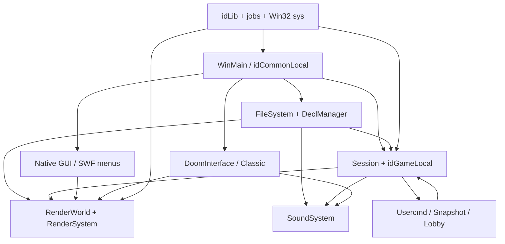

# DOOM 3 BFG 架构总览

DOOM 3 BFG 这份快照包含 Windows 主引擎、DOOM 3 游戏层、经典 DOOM/DOOM II 适配层及构建工具；它不是一个自带完整商业资源的可独立运行发行包。本页为需要修改、调试或移植代码的维护者建立系统地图，具体机制由后续子页面展开。

分析固定到提交 `1caba1979589971b5ed44e315d9ead30b278d8b4`。构建配置以仓库中的 VS2010/Win32 项目为准，不把其他平台 fork 或后续移植的行为混入本快照。

## 产物与代码边界

`neo/doom3.sln` 组合主程序、`idLib`、静态游戏库、`external`、`doomclassic`、`timidity` 和独立 `amplitude` 工具。当前 Win32 项目把 `Game-d3xp` 与 Classic 都静态链接进主程序，因此阅读调用链时不能假设存在游戏 DLL 或 Classic 子进程。[neo/doom3.sln:1-24](https://github.com/id-Software/DOOM-3-BFG/blob/1caba1979589971b5ed44e315d9ead30b278d8b4/neo/doom3.sln#L1-L24) [neo/game-d3xp.vcxproj:32-43](https://github.com/id-Software/DOOM-3-BFG/blob/1caba1979589971b5ed44e315d9ead30b278d8b4/neo/game-d3xp.vcxproj#L32-L43) [neo/doomexe.vcxproj:520-545](https://github.com/id-Software/DOOM-3-BFG/blob/1caba1979589971b5ed44e315d9ead30b278d8b4/neo/doomexe.vcxproj#L520-L545)

| 责任 | 主要代码 | 深入阅读 |
| --- | --- | --- |
| 进程、平台与构建 | `neo/sys/win32`、`neo/framework`、`neo/*.vcxproj` | [构建平台](02-build-platform.md)、[启动帧循环](03-startup-frame.md) |
| 基础设施与资源 | `neo/idlib`、`neo/framework/FileSystem*`、`DeclManager*` | [idLib 与作业](04-idlib-jobs.md)、[文件与声明](05-files-declarations.md) |
| DOOM 3 呈现 | `neo/renderer`、`base/renderprogs` | [渲染架构](06-render-architecture.md)及三叶子页面 |
| DOOM 3 玩法 | `neo/d3xp`、`neo/aas`、`neo/cm` | [游戏运行时](10-game-runtime.md)及六个叶子页面 |
| 会话与多人 | `neo/framework/Session*`、`neo/sys/sys_*`、`neo/d3xp/Game_network.cpp` | [网络、快照与会话](16-network-session.md) |
| UI 与音频 | `neo/ui`、`neo/swf`、`neo/d3xp/menus`、`neo/sound` | [GUI/SWF](17-ui-swf.md)、[音频](18-audio.md) |
| Classic 第二运行时 | `doomclassic` 与 `Common` 中的桥接 | [DOOM Classic](19-doom-classic.md) |

表中项目与工具边界见[构建页的项目表](02-build-platform.md#解决方案与真实构建目标)；源码布局本身只用于定位，不作为运行行为的证据。

## 系统级控制与数据流

入口和 Common 初始化见 [win_main.cpp:1503-1549](https://github.com/id-Software/DOOM-3-BFG/blob/1caba1979589971b5ed44e315d9ead30b278d8b4/neo/sys/win32/win_main.cpp#L1503-L1549) [Common.cpp:936-968](https://github.com/id-Software/DOOM-3-BFG/blob/1caba1979589971b5ed44e315d9ead30b278d8b4/neo/framework/Common.cpp#L936-L968)；游戏和渲染 world 的创建见 [Common.cpp:1131-1160](https://github.com/id-Software/DOOM-3-BFG/blob/1caba1979589971b5ed44e315d9ead30b278d8b4/neo/framework/Common.cpp#L1131-L1160)；资源、游戏、渲染和声音的具体边分别由[文件声明](05-files-declarations.md)、[游戏运行时](10-game-runtime.md)、[渲染架构](06-render-architecture.md)和[音频](18-audio.md)中的直接调用证据支撑。

`idCommonLocal` 是组合根，而不是所有逻辑的所在层。文件系统与声明管理器把 pak/声明转为材质、实体定义、声音等运行对象；Session/Game 推进地图与实体状态；RenderWorld 保存场景定义，RenderSystem 消费命令缓冲；声音系统把逻辑 emitter/channel 映射到 XAudio2 voices。Classic 复用宿主的文件、帧和输出服务，但保留自己的游戏与软件渲染状态。[neo/framework/Common_load.cpp:446-526](https://github.com/id-Software/DOOM-3-BFG/blob/1caba1979589971b5ed44e315d9ead30b278d8b4/neo/framework/Common_load.cpp#L446-L526) [neo/renderer/RenderSystem.h:265-283](https://github.com/id-Software/DOOM-3-BFG/blob/1caba1979589971b5ed44e315d9ead30b278d8b4/neo/renderer/RenderSystem.h#L265-L283) [neo/sound/snd_system.cpp:296-317](https://github.com/id-Software/DOOM-3-BFG/blob/1caba1979589971b5ed44e315d9ead30b278d8b4/neo/sound/snd_system.cpp#L296-L317) [doomclassic/doom/doominterface.cpp:129-188](https://github.com/id-Software/DOOM-3-BFG/blob/1caba1979589971b5ed44e315d9ead30b278d8b4/doomclassic/doom/doominterface.cpp#L129-L188)

## 一次 DOOM 3 外层帧

正常 DOOM 3 路径可压缩为以下顺序：

1. 在帧边界执行游戏切换，排空系统事件和控制台命令。[neo/framework/common_frame.cpp:367-407](https://github.com/id-Software/DOOM-3-BFG/blob/1caba1979589971b5ed44e315d9ead30b278d8b4/neo/framework/common_frame.cpp#L367-L407)
2. 完成/交换上一轮渲染命令，按真实时间决定本轮执行多少个游戏 tic，并处理 session、网络和 UI 输入。[neo/framework/common_frame.cpp:423-440](https://github.com/id-Software/DOOM-3-BFG/blob/1caba1979589971b5ed44e315d9ead30b278d8b4/neo/framework/common_frame.cpp#L423-L440) [neo/framework/common_frame.cpp:548-575](https://github.com/id-Software/DOOM-3-BFG/blob/1caba1979589971b5ed44e315d9ead30b278d8b4/neo/framework/common_frame.cpp#L548-L575)
3. `idGameThread` 对 host/server 或 client 执行相应模拟，再调用 Draw 生成呈现命令；主线程可把后端渲染与下一轮 Game/Draw 重叠。[neo/framework/common_frame.cpp:86-178](https://github.com/id-Software/DOOM-3-BFG/blob/1caba1979589971b5ed44e315d9ead30b278d8b4/neo/framework/common_frame.cpp#L86-L178)
4. 主线程提交 render command buffers，等待游戏线程，发送网络数据、更新声音并消费 `gameReturn_t` 中的会话命令。[neo/framework/common_frame.cpp:622-666](https://github.com/id-Software/DOOM-3-BFG/blob/1caba1979589971b5ed44e315d9ead30b278d8b4/neo/framework/common_frame.cpp#L622-L666)

这里有两个容易破坏的契约：一次外层帧可以运行零个或多个 tic；`RunGameAndDraw` 返回的是上一轮锁存结果，而新一轮可在后台执行。详细时序见[启动、帧循环与线程交接](03-startup-frame.md)和[游戏运行时](10-game-runtime.md)。

## 修改代码时先定位权威边界

- **改资源查找或声明语法：** 从[文件与声明](05-files-declarations.md)开始，再进入材质、实体或声音消费者。
- **改画面：** 先区分 RenderWorld 场景状态、前端可见性/交互和后端 GPU 命令，不要直接在实体 Present 中发 draw call。
- **改玩法：** 区分每 tic 权威状态与 Draw 呈现状态；实体事件、脚本、物理和动画各有独立生命周期。
- **改存档或多人：** 分别核对对象恢复格式与 snapshot/usercmd 协议，两者不是同一种序列化契约。
- **改菜单或 Classic：** 识别原生 GUI、SWF VM 和 Classic `Globals` 三条路径，避免把宿主帧循环重入到旧运行时内部。

## 范围与验证限制

README 明确说明源码发布不包含游戏数据，也不包含 Steam 集成、Bink 视频和 depth-fail 模板阴影后端功能；这些区域在本 Wiki 中只分析公开调用边界或列为排除项，不虚构缺失实现。[README.txt:12-21](https://github.com/id-Software/DOOM-3-BFG/blob/1caba1979589971b5ed44e315d9ead30b278d8b4/README.txt#L12-L21) [README.txt:35-52](https://github.com/id-Software/DOOM-3-BFG/blob/1caba1979589971b5ed44e315d9ead30b278d8b4/README.txt#L35-L52)

本 Wiki 是静态源码分析：未执行 Windows 构建、未启动游戏、未运行自动化测试，也未实测渲染、音频设备或多人联机。完整覆盖矩阵、关键结论台账和对抗审计见[审计报告](audit.md)；术语速查见[术语表](20-glossary.md)。

下一页：[构建、产物与 Win32 平台边界](02-build-platform.md)，或返回[Wiki 总目录](index.md)。
