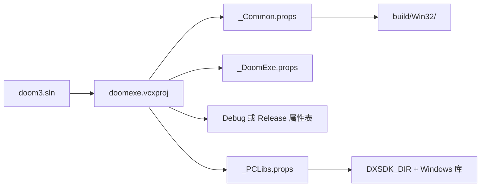

# 构建、产物与 Win32 平台边界

本页回答两个问题：这份 GPL 快照实际提供什么构建入口，以及哪些运行能力必须由商业游戏数据、Windows 或外部 SDK 补齐。它是[启动与帧循环](03-startup-frame.md)的前置阅读；渲染和网络的机制分别见[渲染架构](06-render-architecture.md)与[网络会话](16-network-session.md)。

## 先确认发布物边界

这不是一个自带完整游戏资源的独立发行包。根 README 明确要求另行取得游戏数据并遵守原 EULA，还要求先把游戏补丁到最新版本；因此，成功编译只得到程序，不等于得到可进入地图的安装。[README.txt:12-21](../../_src/DOOM-3-BFG/README.txt#L12-L21)

同一发布说明还列出了三个重要的功能缺口：GPL 版不含 Steam 集成，不含 Bink 视频渲染，也不含以 depth-fail 方式实现模板阴影后端的功能。分析这些子系统时，不能把调用点或空壳误认为发布包内存在对应商业实现。[README.txt:35-52](../../_src/DOOM-3-BFG/README.txt#L35-L52)

## 解决方案与真实构建目标

`neo/doom3.sln` 是 Visual Studio 2010 格式，列出七个项目：`idLib`、主程序 `Doom3BFG`、`Game-d3xp`、命令行工具 `amplitude`、`external`、`doomclassic` 和 `timidity`。解决方案只公开 `Debug|Win32`、`Release|Win32` 和 `Retail|Win32` 三组配置；这里没有专用测试项目或跨平台目标。[neo/doom3.sln:1-24](../../_src/DOOM-3-BFG/neo/doom3.sln#L1-L24)

| 项目 | 在产物中的角色 | 直接证据 |
| --- | --- | --- |
| `Doom3BFG` | Windows 应用程序，三种 Win32 配置均为 `Application` | [neo/doomexe.vcxproj:32-45](../../_src/DOOM-3-BFG/neo/doomexe.vcxproj#L32-L45) |
| `Game-d3xp` | 当前 Win32 三种配置均为静态库，而非默认 DLL | [neo/game-d3xp.vcxproj:32-43](../../_src/DOOM-3-BFG/neo/game-d3xp.vcxproj#L32-L43) |
| `idLib` / `external` | 被主程序引用的库项目 | [neo/doomexe.vcxproj:536-545](../../_src/DOOM-3-BFG/neo/doomexe.vcxproj#L536-L545) |
| `doomclassic` / `timidity` | 主程序直接引用的 Classic 游戏与 MIDI 库 | [neo/doomexe.vcxproj:520-535](../../_src/DOOM-3-BFG/neo/doomexe.vcxproj#L520-L535) |
| `amplitude` | 独立 WAV 到 `.amp` 转换工具，不是游戏进程入口 | [neo/amplitude/amplitude.cpp:297-342](../../_src/DOOM-3-BFG/neo/amplitude/amplitude.cpp#L297-L342) |

主程序的静态链接关系值得特别注意：虽然 `Common.cpp` 保留了 `__DOOM_DLL__` 下的 DLL 加载路径，但当前 Win32 项目把 `Game-d3xp` 配成 `StaticLibrary`。修改游戏层时，应按本快照的实际项目装配理解，而不要默认它一定运行一个外置游戏 DLL。[neo/game-d3xp.vcxproj:32-43](../../_src/DOOM-3-BFG/neo/game-d3xp.vcxproj#L32-L43) [neo/framework/Common.cpp:820-873](../../_src/DOOM-3-BFG/neo/framework/Common.cpp#L820-L873)

## 前置条件与配置继承

README 指定 Visual Studio 2010 解决方案和 Microsoft DirectX SDK，并给出 June 2010 SDK 的默认安装位置；若 SDK 不在该处，需要调整项目设置。[README.txt:24-32](../../_src/DOOM-3-BFG/README.txt#L24-L32) 项目文件进一步把 `$(DXSDK_DIR)\Include` 和 `$(DXSDK_DIR)\Lib\x86` 加入编译、链接搜索路径，并链接 XInput、DirectInput、DSound、OpenGL、WinMM、Winsock 和 X3DAudio 等系统库。[neo/_PCLibs.props:16-23](../../_src/DOOM-3-BFG/neo/_PCLibs.props#L16-L23)

各配置不是孤立复制参数，而是组合属性表：

图依据：主程序在 Debug 配置导入 `_Common`、`_DoomExe`、`_Debug`、`_WithInlines`、`_PCLibs`，Release/Retail 则换用 `_Release`。[neo/doomexe.vcxproj:49-69](../../_src/DOOM-3-BFG/neo/doomexe.vcxproj#L49-L69)

共同属性把输出目录设为 `neo/../build/$(PlatformName)/$(Configuration)/`，中间目录按项目隔离，并打开多处理器编译；因此按解决方案默认值构建时，产物根目录是仓库的 `build/Win32/<Configuration>/`。[neo/_Common.props:3-18](../../_src/DOOM-3-BFG/neo/_Common.props#L3-L18) 主程序属性还定义 `__DOOM__`、使用预编译头、保留 16 MiB 栈并启用 large-address-aware。[neo/_DoomExe.props:7-16](../../_src/DOOM-3-BFG/neo/_DoomExe.props#L7-L16)

Debug 使用 `MultiThreadedDebug`、快速运行时检查和 PDB；Release 使用最大速度优化、`MultiThreaded`、NDEBUG 和函数级链接。这些是项目配置事实，不代表本 Wiki 已测量两种构建的运行性能。[neo/_Debug.props:8-21](../../_src/DOOM-3-BFG/neo/_Debug.props#L8-L21) [neo/_Release.props:8-25](../../_src/DOOM-3-BFG/neo/_Release.props#L8-L25)

## 可复现的构建步骤

在与该快照匹配的 Windows 开发环境中，最小流程是：

1. 安装 Visual Studio 2010 与 June 2010 DirectX SDK，并确认 `DXSDK_DIR` 指向 SDK。
2. 用 VS2010 打开 `neo/doom3.sln`，选择 `Release` 或 `Debug` 以及 `Win32`；也可在与项目工具链匹配的开发者命令行中执行 `msbuild neo/doom3.sln /p:Configuration=Release /p:Platform=Win32`。
3. 从 `build/Win32/Release/` 或对应配置目录取主程序，再把它放入具有合法、已补丁游戏数据的安装环境。

命令由解决方案及其配置推导，**没有在本机执行**；当前分析环境不是该 VS2010/Win32 工具链，且仓库没有商业游戏数据。构建前提与数据要求分别来自项目文件和 README，而不是一次成功运行的记录。[neo/doom3.sln:20-24](../../_src/DOOM-3-BFG/neo/doom3.sln#L20-L24) [README.txt:15-32](../../_src/DOOM-3-BFG/README.txt#L15-L32)

## 平台层并不是可替换注解

主进程入口是 `neo/sys/win32/win_main.cpp` 的 `WinMain`，它在调用 `common->Init` 前直接完成等待光标、工作集、控制台、临界区、毫秒计时精度和 FPU 精度等 Windows 初始化。[neo/sys/win32/win_main.cpp:1460-1506](../../_src/DOOM-3-BFG/neo/sys/win32/win_main.cpp#L1460-L1506) 这意味着移植并不只是更换窗口创建函数：计时、线程原语、输入、网络、OpenGL 上下文、XAudio2 以及保存/会话服务都可能触及平台边界。

`BuildVersion.h` 把当前 `BUILD_NUMBER` 固定为 `1400`， minor 为 `0`；其中注释说明 1400 与存档详情格式变化相关。因此它既是版本标识，也可能影响存档兼容逻辑，不应被当作无害显示字符串随意修改。[neo/framework/BuildVersion.h:29-32](../../_src/DOOM-3-BFG/neo/framework/BuildVersion.h#L29-L32)

## 修改时的边界检查

- 改项目依赖时，同时检查解决方案依赖和 `.vcxproj` 的 `ProjectReference`；主程序对 `Game-d3xp` 的依赖在两个层级都有记录。[neo/doom3.sln:5-10](../../_src/DOOM-3-BFG/neo/doom3.sln#L5-L10) [neo/doomexe.vcxproj:539-545](../../_src/DOOM-3-BFG/neo/doomexe.vcxproj#L539-L545)
- 改编译宏时，检查它是否改变链接模型或许可证相关功能；不要仅因某段条件编译源码存在，就认定当前配置会编译它。
- 改存档格式时，追踪 `BUILD_NUMBER` 的消费方以及[持久化](15-persistence.md)页面的版本检查，而不是只递增版本号。
- 新增平台时，把本页视为适配清单而非可移植性承诺；本快照没有 CMake、CI 或自动化测试入口可提供额外验证。

返回[总入口](index.md)。
