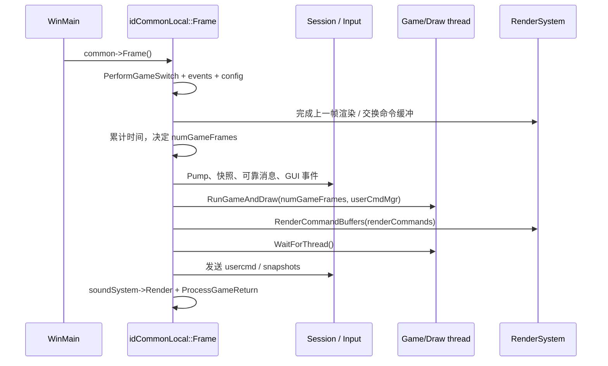

# 启动、帧循环与线程交接

本页沿实际调用链解释进程如何进入 `idCommonLocal`，一次外层循环如何变成零次或多次游戏 tic，以及游戏/绘制线程怎样与渲染后端重叠。它是理解[游戏运行时](10-game-runtime.md)、[渲染帧交接](07-render-frame.md)和[Classic 集成](19-doom-classic.md)的共同基础。

## 关键源码

- `neo/sys/win32/win_main.cpp`：Win32 入口和无限主循环。
- `neo/framework/Common.cpp`：子系统初始化与逆序拆除。
- `neo/framework/common_frame.cpp`：计时、输入、游戏线程、渲染和音频的帧级编排。
- `neo/framework/EventLoop.cpp`：系统事件与控制台命令的排空。

## 从 WinMain 到可运行引擎

`WinMain` 先建立 Windows 进程环境，再调用 `common->Init(0, NULL, lpCmdLine)`；初始化返回后进入 `while(1)`，每轮依次执行 `Win_Frame()`、调试内存/FPU 处理和 `common->Frame()`。因此主循环的真正主体在 framework，而不是 `Win_Frame`——后者在本快照只处理日志窗口 CVar 的修改标记。[neo/sys/win32/win_main.cpp:1503-1506](https://github.com/id-Software/DOOM-3-BFG/blob/1caba1979589971b5ed44e315d9ead30b278d8b4/neo/sys/win32/win_main.cpp#L1503-L1506) [neo/sys/win32/win_main.cpp:1532-1549](https://github.com/id-Software/DOOM-3-BFG/blob/1caba1979589971b5ed44e315d9ead30b278d8b4/neo/sys/win32/win_main.cpp#L1532-L1549) [neo/sys/win32/win_main.cpp:1260-1265](https://github.com/id-Software/DOOM-3-BFG/blob/1caba1979589971b5ed44e315d9ead30b278d8b4/neo/sys/win32/win_main.cpp#L1260-L1265)

`idCommonLocal::Init` 的顺序具有依赖意义：

1. 把 `sys/common/cvarSystem/fileSystem` 接口注入 `idLib` 并初始化基础层，再解析命令行、初始化命令和 CVar 系统。[neo/framework/Common.cpp:936-968](https://github.com/id-Software/DOOM-3-BFG/blob/1caba1979589971b5ed44e315d9ead30b278d8b4/neo/framework/Common.cpp#L936-L968)
2. 初始化输入、控制台、Sys、网络、SIMD 和文件系统；随后初始化声明、事件循环及并行作业管理器。[neo/framework/Common.cpp:975-1025](https://github.com/id-Software/DOOM-3-BFG/blob/1caba1979589971b5ed44e315d9ead30b278d8b4/neo/framework/Common.cpp#L975-L1025)
3. 执行 `default.cfg`、可选配置和 `autoexec.cfg`，然后再次应用命令行覆盖，使命令行优先级高于配置文件。[neo/framework/Common.cpp:1027-1046](https://github.com/id-Software/DOOM-3-BFG/blob/1caba1979589971b5ed44e315d9ead30b278d8b4/neo/framework/Common.cpp#L1027-L1046)
4. 初始化 OpenGL、声音和渲染数据结构，再启动 `Game/Draw` 工作线程、输入、UI 和游戏模块。[neo/framework/Common.cpp:1048-1059](https://github.com/id-Software/DOOM-3-BFG/blob/1caba1979589971b5ed44e315d9ead30b278d8b4/neo/framework/Common.cpp#L1048-L1059) [neo/framework/Common.cpp:1090-1114](https://github.com/id-Software/DOOM-3-BFG/blob/1caba1979589971b5ed44e315d9ead30b278d8b4/neo/framework/Common.cpp#L1090-L1114)
5. 分配共享 `renderWorld`、游戏 `soundWorld` 和独立菜单声音世界，初始化会话与主菜单；最后结束启动级资源加载并设置 `com_fullyInitialized`。[neo/framework/Common.cpp:1131-1160](https://github.com/id-Software/DOOM-3-BFG/blob/1caba1979589971b5ed44e315d9ead30b278d8b4/neo/framework/Common.cpp#L1131-L1160) [neo/framework/Common.cpp:1184-1212](https://github.com/id-Software/DOOM-3-BFG/blob/1caba1979589971b5ed44e315d9ead30b278d8b4/neo/framework/Common.cpp#L1184-L1212)

这里“初始化完成”不等于“地图已经生成”。地图生命周期由会话状态和 `ExecuteMapChange` 驱动，详见[游戏运行时](10-game-runtime.md)。

## 一次外层帧的编排

图依据：帧首事件与游戏切换见 [common_frame.cpp:367-407](https://github.com/id-Software/DOOM-3-BFG/blob/1caba1979589971b5ed44e315d9ead30b278d8b4/neo/framework/common_frame.cpp#L367-L407)，渲染同步见 [common_frame.cpp:423-440](https://github.com/id-Software/DOOM-3-BFG/blob/1caba1979589971b5ed44e315d9ead30b278d8b4/neo/framework/common_frame.cpp#L423-L440)，会话与网络见 [common_frame.cpp:548-575](https://github.com/id-Software/DOOM-3-BFG/blob/1caba1979589971b5ed44e315d9ead30b278d8b4/neo/framework/common_frame.cpp#L548-L575)，游戏/渲染/声音交接见 [common_frame.cpp:622-666](https://github.com/id-Software/DOOM-3-BFG/blob/1caba1979589971b5ed44e315d9ead30b278d8b4/neo/framework/common_frame.cpp#L622-L666)。

帧首先递增全局 `idLib::frameNumber`，处理 Classic 切换、系统事件和配置写回。`eventLoop->RunEventLoop()` 在每取下一个事件前执行已缓冲命令，直到 `SE_NONE`；控制台事件直接追加到命令缓冲，其他事件交给 `common->ProcessEvent`，并释放事件附带的堆数据。[neo/framework/EventLoop.cpp:149-166](https://github.com/id-Software/DOOM-3-BFG/blob/1caba1979589971b5ed44e315d9ead30b278d8b4/neo/framework/EventLoop.cpp#L149-L166) [neo/framework/EventLoop.cpp:174-191](https://github.com/id-Software/DOOM-3-BFG/blob/1caba1979589971b5ed44e315d9ead30b278d8b4/neo/framework/EventLoop.cpp#L174-L191)

控制台、对话框、系统 UI 或游戏 shell 会改变鼠标捕获和输入抑制；非多人模式下，这些界面还可令 `pauseGame` 为真。这里的暂停是帧编排条件，不是简单停止整个主循环：事件、渲染和菜单声音仍然继续。[neo/framework/common_frame.cpp:398-409](https://github.com/id-Software/DOOM-3-BFG/blob/1caba1979589971b5ed44e315d9ead30b278d8b4/neo/framework/common_frame.cpp#L398-L409)

## 游戏 tic 的时间模型

默认 `com_engineHz` 是 60，允许范围为 10–1024；帧号与毫秒通过整数比例互转，避免每帧直接依赖浮点除法。[neo/framework/Common.cpp:83-86](https://github.com/id-Software/DOOM-3-BFG/blob/1caba1979589971b5ed44e315d9ead30b278d8b4/neo/framework/Common.cpp#L83-L86) [neo/framework/Common.h:40-59](https://github.com/id-Software/DOOM-3-BFG/blob/1caba1979589971b5ed44e315d9ead30b278d8b4/neo/framework/Common.h#L40-L59)

每轮把真实时间差先按 `com_deltaTimeClamp` 限幅，再乘 `timescale` 加入 `gameTimeResidual`。只要残余时间足以覆盖下一个 tic，就递增 `gameFrame` 和 `numGameFrames`；不足时通常 `Sys_Sleep(0)` 后重试。由此，**外层渲染帧和游戏 tic 不是同义词**：一次外层帧可携带多个输入命令并运行多个 tic。[neo/framework/common_frame.cpp:469-540](https://github.com/id-Software/DOOM-3-BFG/blob/1caba1979589971b5ed44e315d9ead30b278d8b4/neo/framework/common_frame.cpp#L469-L540)

边界分支不能省略：

- 暂停时不清空游戏对象，而是把残余时间清零、推进时间帧号，并保持 `numGameFrames == 0`，所以不会执行游戏 `RunFrame`。[neo/framework/common_frame.cpp:482-489](https://github.com/id-Software/DOOM-3-BFG/blob/1caba1979589971b5ed44e315d9ead30b278d8b4/neo/framework/common_frame.cpp#L482-L489)
- `com_fixedTic` 可强制 tic 数；`syncNextGameFrame` 可要求立即补一个 tic；`com_noSleep` 则在时间不足时仍强制至少一个 tic。[neo/framework/common_frame.cpp:491-539](https://github.com/id-Software/DOOM-3-BFG/blob/1caba1979589971b5ed44e315d9ead30b278d8b4/neo/framework/common_frame.cpp#L491-L539)
- 同一个新 `usercmd` 会按待运行 tic 数复制到命令管理器，但每项被赋予不同的 `clientGameMilliseconds`；客户端的 `serverGameMilliseconds` 还被钳制到快照结束时间，避免外推越过已接收快照。[neo/framework/common_frame.cpp:598-615](https://github.com/id-Software/DOOM-3-BFG/blob/1caba1979589971b5ed44e315d9ead30b278d8b4/neo/framework/common_frame.cpp#L598-L615)

## Game/Draw 与渲染后端的流水线

即使关闭 SMP，初始化仍会创建 `Game/Draw` 工作线程；`RunGameAndDraw` 在 `com_smp == false` 时直接于主线程调用 `Run()`，开启时则只发信号让后台线程运行。[neo/framework/Common.cpp:1095-1098](https://github.com/id-Software/DOOM-3-BFG/blob/1caba1979589971b5ed44e315d9ead30b278d8b4/neo/framework/Common.cpp#L1095-L1098) [neo/framework/common_frame.cpp:155-178](https://github.com/id-Software/DOOM-3-BFG/blob/1caba1979589971b5ed44e315d9ead30b278d8b4/neo/framework/common_frame.cpp#L155-L178)

`idGameThread::Run` 对客户端调用 `game->ClientRunFrame`，否则调用 `game->RunFrame`，可循环执行多个 tic；遇到 `syncNextGameFrame` 或非空 `sessionCommand` 会提前停止。游戏逻辑结束后，同一线程再执行 `commonLocal.Draw()` 构建渲染命令和几何。[neo/framework/common_frame.cpp:94-142](https://github.com/id-Software/DOOM-3-BFG/blob/1caba1979589971b5ed44e315d9ead30b278d8b4/neo/framework/common_frame.cpp#L94-L142)

两种模式的差别在命令年龄：

| 模式 | 游戏/绘制 | 后端执行的命令 | 同步点 |
| --- | --- | --- | --- |
| SMP 开 | 后台生成当前帧命令 | 帧首交换得到的上一组命令 | 后端提交后等待 Game/Draw 完成 |
| SMP 关 | 主线程同步生成 | 随即交换出的当前命令 | `RunGameAndDraw` 内已同步执行 |

表依据：SMP 分支在帧首 `SwapCommandBuffers`，非 SMP 在游戏生成后 `SwapCommandBuffers_FinishCommandBuffers`；两条路径随后都调用 `RenderCommandBuffers` 并等待游戏线程。[neo/framework/common_frame.cpp:430-440](https://github.com/id-Software/DOOM-3-BFG/blob/1caba1979589971b5ed44e315d9ead30b278d8b4/neo/framework/common_frame.cpp#L430-L440) [neo/framework/common_frame.cpp:622-645](https://github.com/id-Software/DOOM-3-BFG/blob/1caba1979589971b5ed44e315d9ead30b278d8b4/neo/framework/common_frame.cpp#L622-L645)

该结构允许游戏/绘制与 CPU 渲染后端重叠，但不是“所有子系统都无锁并行”。帧尾仍必须等待 Game/Draw，再发送 usercmd/snapshot、渲染声音并处理 `gameReturn_t`；任何跨线程修改都应先确认这些显式交接点。[neo/framework/common_frame.cpp:643-666](https://github.com/id-Software/DOOM-3-BFG/blob/1caba1979589971b5ed44e315d9ead30b278d8b4/neo/framework/common_frame.cpp#L643-L666)

## 会话状态可以截断正常帧

在输入生成前，主线程泵送登录和会话。如果会话进入 `LOADING`，本帧直接执行地图切换并返回；如果地图已生成但会话不再 `INGAME`，则离开游戏并返回。客户端在非暂停时才处理网络快照。因此会话异步事件不是延迟到下一局才生效的旁路，而是能改变当前帧后半段是否存在的控制流。[neo/framework/common_frame.cpp:548-570](https://github.com/id-Software/DOOM-3-BFG/blob/1caba1979589971b5ed44e315d9ead30b278d8b4/neo/framework/common_frame.cpp#L548-L570)

## 关闭与失败边界

`idCommonLocal::Shutdown` 用 `com_shuttingDown` 防止重入，先取消待写入存档并停止声音，再停止游戏、删除世界、关闭会话/UI/声音/输入/事件/声明/渲染，最后关闭文件系统、Sys、控制台、CVar、命令系统和 idLib。[neo/framework/Common.cpp:1225-1250](https://github.com/id-Software/DOOM-3-BFG/blob/1caba1979589971b5ed44e315d9ead30b278d8b4/neo/framework/Common.cpp#L1225-L1250) [neo/framework/Common.cpp:1271-1357](https://github.com/id-Software/DOOM-3-BFG/blob/1caba1979589971b5ed44e315d9ead30b278d8b4/neo/framework/Common.cpp#L1271-L1357)

`Sys_Quit` 在 Win32 上恢复计时器周期、关闭输入和控制台后直接 `ExitProcess(0)`；正常主循环本身没有退出条件。因此新增退出路径时，必须明确它是否经过 `idCommonLocal::Shutdown`，不能把 `Sys_Quit` 当作通用资源清理函数。[neo/sys/win32/win_main.cpp:316-321](https://github.com/id-Software/DOOM-3-BFG/blob/1caba1979589971b5ed44e315d9ead30b278d8b4/neo/sys/win32/win_main.cpp#L316-L321) [neo/sys/win32/win_main.cpp:1532-1549](https://github.com/id-Software/DOOM-3-BFG/blob/1caba1979589971b5ed44e315d9ead30b278d8b4/neo/sys/win32/win_main.cpp#L1532-L1549)

返回[总入口](index.md)。
