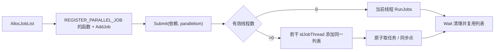

# idLib 基础层与并行作业

`idLib` 不是独立的工具箱集合：它向引擎提供全局服务入口、内存与容器约定、数学/SIMD 分派和细粒度作业运行时。理解这些契约后，才能安全修改[渲染可见性](09-visibility-lighting.md)或[物理模拟](13-physics-collision.md)中的热路径。

## 初始化与全局服务

`Common` 在初始化其他子系统前先填入 `idLib::sys/common/cvarSystem/fileSystem`；`idLib::Init` 随后标记主线程、初始化字节交换、字符串内存、通用 SIMD、数学和字典池。[neo/framework/Common.cpp:936-945](https://github.com/id-Software/DOOM-3-BFG/blob/1caba1979589971b5ed44e315d9ead30b278d8b4/neo/framework/Common.cpp#L936-L945) [neo/idlib/Lib.cpp:61-90](https://github.com/id-Software/DOOM-3-BFG/blob/1caba1979589971b5ed44e315d9ead30b278d8b4/neo/idlib/Lib.cpp#L61-L90) 因此，在静态对象构造阶段就调用依赖这些指针的 idLib 服务，与初始化后的游戏代码具有不同风险。

`idLib::frameNumber` 也定义在这里，但只在 `idCommonLocal::Frame` 的一处递增；它描述外层引擎帧，不等于可能一次执行多个的游戏 tic。[neo/idlib/Lib.cpp:46-52](https://github.com/id-Software/DOOM-3-BFG/blob/1caba1979589971b5ed44e315d9ead30b278d8b4/neo/idlib/Lib.cpp#L46-L52) [neo/framework/common_frame.cpp:367-373](https://github.com/id-Software/DOOM-3-BFG/blob/1caba1979589971b5ed44e315d9ead30b278d8b4/neo/framework/common_frame.cpp#L367-L373)

## 内存与容器的实际约定

当前 PC 实现的 `Mem_Alloc16` 将大小向上取整到 16 字节并调用 `_aligned_malloc`，`Mem_Free16` 对应 `_aligned_free`；零字节分配返回空指针。通常使用的 `Mem_Alloc/Mem_Free` 是这两个函数的内联别名。[neo/idlib/Heap.cpp:45-63](https://github.com/id-Software/DOOM-3-BFG/blob/1caba1979589971b5ed44e315d9ead30b278d8b4/neo/idlib/Heap.cpp#L45-L63) [neo/idlib/Heap.h:52-56](https://github.com/id-Software/DOOM-3-BFG/blob/1caba1979589971b5ed44e315d9ead30b278d8b4/neo/idlib/Heap.h#L52-L56) 配对新旧分配接口时不要混用 CRT `free`，也不要假设 `memTag_t` 参数会在这条底层路径中改变分配器。

`idList<T>` 明确区分元素数 `num`、已分配容量 `size` 和增长粒度。`SetNum` 只在需要时扩容，`AssureSize` 按 granularity 对齐容量，`Resize` 则重分配到请求容量并保留已有内容。[neo/idlib/containers/List.h:106-143](https://github.com/id-Software/DOOM-3-BFG/blob/1caba1979589971b5ed44e315d9ead30b278d8b4/neo/idlib/containers/List.h#L106-L143) [neo/idlib/containers/List.h:338-344](https://github.com/id-Software/DOOM-3-BFG/blob/1caba1979589971b5ed44e315d9ead30b278d8b4/neo/idlib/containers/List.h#L338-L344) [neo/idlib/containers/List.h:466-480](https://github.com/id-Software/DOOM-3-BFG/blob/1caba1979589971b5ed44e315d9ead30b278d8b4/neo/idlib/containers/List.h#L466-L480) 扩容会移动底层数组，所以不能在可能 `Append/AssureSize/Resize` 的代码段中长期保存 `Ptr()` 或元素引用。

删除 API 也有顺序差别：`RemoveIndexFast` 用末尾元素填补空洞，明确不保持顺序；遍历索引、网络顺序或呈现顺序有意义的列表时，不能为省事把它当成等价替代。[neo/idlib/containers/List.h:149-158](https://github.com/id-Software/DOOM-3-BFG/blob/1caba1979589971b5ed44e315d9ead30b278d8b4/neo/idlib/containers/List.h#L149-L158)

`idStr` 内部保存长度、数据指针、分配量/静态标志和内置 `baseBuffer`，因此短字符串可留在对象内部，长字符串或派生静态缓冲则走不同存储路径。[neo/idlib/Str.h:346-370](https://github.com/id-Software/DOOM-3-BFG/blob/1caba1979589971b5ed44e315d9ead30b278d8b4/neo/idlib/Str.h#L346-L370) 这也是复制、交接和存档代码应使用既有 `idStr` 语义，而不是把 `data` 当独立所有权指针的原因。

## SIMD 是运行时分派

基础初始化只创建通用实现；`InitProcessor` 再读取处理器能力，在支持 MMX+SSE 时创建 `idSIMD_SSE`，否则保留通用实现，`forceGeneric` 可强制回退。[neo/idlib/math/Simd.cpp:44-81](https://github.com/id-Software/DOOM-3-BFG/blob/1caba1979589971b5ed44e315d9ead30b278d8b4/neo/idlib/math/Simd.cpp#L44-L81) `Common` 在系统初始化之后调用 `InitSIMD`，帧循环还允许 `com_forceGenericSIMD` 修改后重新分派。[neo/framework/Common.cpp:981-998](https://github.com/id-Software/DOOM-3-BFG/blob/1caba1979589971b5ed44e315d9ead30b278d8b4/neo/framework/Common.cpp#L981-L998) [neo/framework/common_frame.cpp:371-378](https://github.com/id-Software/DOOM-3-BFG/blob/1caba1979589971b5ed44e315d9ead30b278d8b4/neo/framework/common_frame.cpp#L371-L378)

`Simd.h` 声明所有 `idSIMDProcessor` 例程线程安全，但这只覆盖 SIMD 接口本身，不自动使调用方共享的输入/输出缓冲线程安全。[neo/idlib/math/Simd.h:35-46](https://github.com/id-Software/DOOM-3-BFG/blob/1caba1979589971b5ed44e315d9ead30b278d8b4/neo/idlib/math/Simd.h#L35-L46)

## 作业列表的生命周期

`idParallelJobManager` 是分配和释放 `idParallelJobList` 的唯一公开入口；调用方向列表添加已注册函数和参数，插入可选同步点，然后 `Submit` 并 `Wait/TryWait`。[neo/idlib/ParallelJobList.h:80-95](https://github.com/id-Software/DOOM-3-BFG/blob/1caba1979589971b5ed44e315d9ead30b278d8b4/neo/idlib/ParallelJobList.h#L80-L95) [neo/idlib/ParallelJobList.h:131-147](https://github.com/id-Software/DOOM-3-BFG/blob/1caba1979589971b5ed44e315d9ead30b278d8b4/neo/idlib/ParallelJobList.h#L131-L147)

函数注册不是可选的调试装饰：`AddJob` 断言函数已注册，`REGISTER_PARALLEL_JOB(function, name)` 通过静态注册对象同时提供允许检查与性能分析名称。[neo/idlib/ParallelJobList.h:159-175](https://github.com/id-Software/DOOM-3-BFG/blob/1caba1979589971b5ed44e315d9ead30b278d8b4/neo/idlib/ParallelJobList.h#L159-L175) [neo/idlib/ParallelJobList.cpp:62-105](https://github.com/id-Software/DOOM-3-BFG/blob/1caba1979589971b5ed44e315d9ead30b278d8b4/neo/idlib/ParallelJobList.cpp#L62-L105) [neo/idlib/ParallelJobList.cpp:735-738](https://github.com/id-Software/DOOM-3-BFG/blob/1caba1979589971b5ed44e315d9ead30b278d8b4/neo/idlib/ParallelJobList.cpp#L735-L738)

图依据：管理器提交实现根据并行度选择内联执行或把列表交给多个工作线程。[neo/idlib/ParallelJobList.cpp:1267-1296](https://github.com/id-Software/DOOM-3-BFG/blob/1caba1979589971b5ed44e315d9ead30b278d8b4/neo/idlib/ParallelJobList.cpp#L1267-L1296)

`Submit` 要求列表已经完成上一轮，设置依赖 guard 和完成统计，并追加 `JOB_LIST_DONE` 终止任务；如果列表为空则直接返回。[neo/idlib/ParallelJobList.cpp:376-421](https://github.com/id-Software/DOOM-3-BFG/blob/1caba1979589971b5ed44e315d9ead30b278d8b4/neo/idlib/ParallelJobList.cpp#L376-L421) `Wait` 不是睡眠锁等待：它在任务计数和执行线程数归零前反复 `Sys_Yield`，随后清空任务与同步点，使列表能够复用。[neo/idlib/ParallelJobList.cpp:429-459](https://github.com/id-Software/DOOM-3-BFG/blob/1caba1979589971b5ed44e315d9ead30b278d8b4/neo/idlib/ParallelJobList.cpp#L429-L459) 这意味着忘记 `Wait` 会阻碍安全复用，而在关键路径长时间忙等也会直接占用调用线程。

并行度并不固定等于核心数。默认使用 `jobs_numThreads`；特殊值可请求逻辑核心数或最大作业线程数，显式值会被上限截断。有效线程数小于等于零时，列表在提交线程立即执行。[neo/idlib/ParallelJobList.h:60-64](https://github.com/id-Software/DOOM-3-BFG/blob/1caba1979589971b5ed44e315d9ead30b278d8b4/neo/idlib/ParallelJobList.h#L60-L64) [neo/idlib/ParallelJobList.cpp:1267-1291](https://github.com/id-Software/DOOM-3-BFG/blob/1caba1979589971b5ed44e315d9ead30b278d8b4/neo/idlib/ParallelJobList.cpp#L1267-L1291)

## 真实调用方揭示的数据约束

渲染前端为每个 `viewEntity_t` 添加 `R_AddSingleModel` 作业，提交后立即等待；关闭对应 CVar 时则顺序调用同一函数。阴影卷任务也使用相同列表。[neo/renderer/tr_frontend_addmodels.cpp:1003-1023](https://github.com/id-Software/DOOM-3-BFG/blob/1caba1979589971b5ed44e315d9ead30b278d8b4/neo/renderer/tr_frontend_addmodels.cpp#L1003-L1023) [neo/renderer/tr_frontend_addmodels.cpp:1025-1042](https://github.com/id-Software/DOOM-3-BFG/blob/1caba1979589971b5ed44e315d9ead30b278d8b4/neo/renderer/tr_frontend_addmodels.cpp#L1025-L1042)

这个例子说明作业参数是原始指针，作业系统并不复制 `viewEntity_t` 或管理其生命周期。调用方必须保证：

- 参数及共享场景数据一直存活到 `Wait` 完成；
- 各任务写入的帧内存、链表或计数器有既定分片/同步策略；
- 任务函数经过 `REGISTER_PARALLEL_JOB` 注册；
- 串行和并行路径在逻辑上等价，而不是只比较是否“能跑”。

释放列表时，管理器先等待工作线程，再等待并删除列表，注释明确指出删除不是线程安全操作。[neo/idlib/ParallelJobList.cpp:1199-1211](https://github.com/id-Software/DOOM-3-BFG/blob/1caba1979589971b5ed44e315d9ead30b278d8b4/neo/idlib/ParallelJobList.cpp#L1199-L1211)

## 同步原语的边界

`idSysMutex`、`idSysSignal` 和 interlocked 类型是操作系统原语的薄封装。尤其 `idSysInterlockedInteger::SetValue` 的注释明确标为非原子，`GetValue` 也只是读取；不要把整个类型名误解为每次操作都带同步语义。[neo/idlib/Thread.h:68-95](https://github.com/id-Software/DOOM-3-BFG/blob/1caba1979589971b5ed44e315d9ead30b278d8b4/neo/idlib/Thread.h#L68-L95) [neo/idlib/Thread.h:97-127](https://github.com/id-Software/DOOM-3-BFG/blob/1caba1979589971b5ed44e315d9ead30b278d8b4/neo/idlib/Thread.h#L97-L127)

返回[总入口](index.md)。
