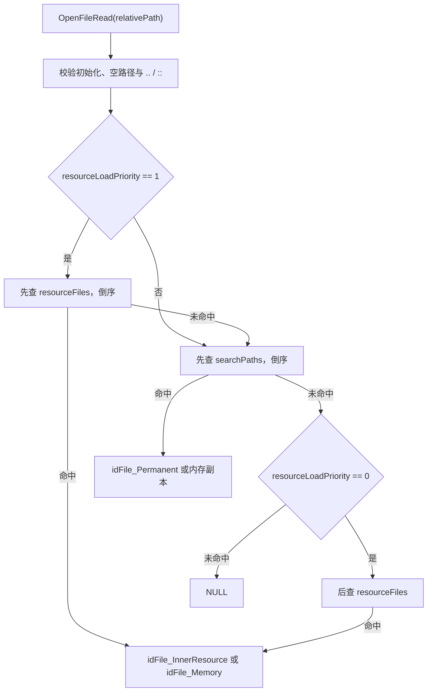

# 虚拟文件系统、资源容器与声明

本页追踪一个逻辑资源名如何穿过搜索路径和 `.resources` 容器，随后如何被声明管理器扫描、惰性解析并供材质、声音或实体使用。下游机制见[材质与图像](08-materials-images.md)、[实体与地图](11-entities-map.md)和[音频](18-audio.md)。

## 关键源码

- `neo/framework/FileSystem.cpp`：路径、容器查找、读写和关卡资源生命周期。
- `neo/framework/File_Resource.*`：`.resources` 的索引、内部文件与构建工具。
- `neo/framework/DeclManager.cpp`：声明类型注册、文件扫描、默认化和重载。
- `neo/idlib/Lexer.*` / `Parser.*`：声明文本的词法与语法基础。

## 启动时建立搜索空间

文件系统在一般命令行 CVar 处理之前单独读取 `fs_basepath`、`fs_savepath`、`fs_game`、`fs_game_base` 和 `fs_copyfiles`；未指定的基础/保存路径由 Sys 默认值补齐。`Startup` 先设置 `BASE_GAMEDIR`，再按条件叠加两个 mod 路径。[neo/framework/FileSystem.cpp:2594-2613](https://github.com/id-Software/DOOM-3-BFG/blob/1caba1979589971b5ed44e315d9ead30b278d8b4/neo/framework/FileSystem.cpp#L2594-L2613) [neo/framework/FileSystem.cpp:2545-2563](https://github.com/id-Software/DOOM-3-BFG/blob/1caba1979589971b5ed44e315d9ead30b278d8b4/neo/framework/FileSystem.cpp#L2545-L2563)

`SetupGameDirectories` 对每个游戏目录同时添加 basepath 和 savepath。`AddGameDirectory` 保存搜索路径，并扫描该目录下排序后的 `.resources` 文件；每个有效容器被追加到 `resourceFiles`。[neo/framework/FileSystem.cpp:2433-2467](https://github.com/id-Software/DOOM-3-BFG/blob/1caba1979589971b5ed44e315d9ead30b278d8b4/neo/framework/FileSystem.cpp#L2433-L2467) [neo/framework/FileSystem.cpp:2477-2485](https://github.com/id-Software/DOOM-3-BFG/blob/1caba1979589971b5ed44e315d9ead30b278d8b4/neo/framework/FileSystem.cpp#L2477-L2485)

初始化最后尝试读取 `default.cfg`，读不到就触发致命错误。这份源码不能作为“零资源专用服务器”直接运行，启动资源仍需实际安装数据支持。[neo/framework/FileSystem.cpp:2612-2621](https://github.com/id-Software/DOOM-3-BFG/blob/1caba1979589971b5ed44e315d9ead30b278d8b4/neo/framework/FileSystem.cpp#L2612-L2621) [README.txt:15-18](https://github.com/id-Software/DOOM-3-BFG/blob/1caba1979589971b5ed44e315d9ead30b278d8b4/README.txt#L15-L18)

## 一次 OpenFileRead 的查找顺序

图依据：资源优先和目录优先的两个阶段位于 [FileSystem.cpp:2813-2833](https://github.com/id-Software/DOOM-3-BFG/blob/1caba1979589971b5ed44e315d9ead30b278d8b4/neo/framework/FileSystem.cpp#L2813-L2833)，目录未命中后的资源回退位于 [FileSystem.cpp:2922-2937](https://github.com/id-Software/DOOM-3-BFG/blob/1caba1979589971b5ed44e315d9ead30b278d8b4/neo/framework/FileSystem.cpp#L2922-L2937)。`fs_resourceLoadPriority` 默认是 1。[neo/framework/FileSystem.cpp:288-290](https://github.com/id-Software/DOOM-3-BFG/blob/1caba1979589971b5ed44e315d9ead30b278d8b4/neo/framework/FileSystem.cpp#L288-L290)

读取前会去掉一个开头斜杠，并拒绝包含 `..` 或 `::` 的相对路径；空路径同样失败。目录搜索从 `searchPaths` 尾部向前，资源索引查找也从容器尾部向前，因此后加入的路径/容器具有覆盖机会。[neo/framework/FileSystem.cpp:2780-2807](https://github.com/id-Software/DOOM-3-BFG/blob/1caba1979589971b5ed44e315d9ead30b278d8b4/neo/framework/FileSystem.cpp#L2780-L2807) [neo/framework/FileSystem.cpp:2821-2844](https://github.com/id-Software/DOOM-3-BFG/blob/1caba1979589971b5ed44e315d9ead30b278d8b4/neo/framework/FileSystem.cpp#L2821-L2844) [neo/framework/FileSystem.cpp:2688-2715](https://github.com/id-Software/DOOM-3-BFG/blob/1caba1979589971b5ed44e315d9ead30b278d8b4/neo/framework/FileSystem.cpp#L2688-L2715)

`ReadFile` 是更高层的所有权包装：找不到时返回 -1；只查询长度时关闭文件并返回长度；要求缓冲时分配 `len+1` 字节、读入并补 NUL。调用方之后用 `FreeFile` 释放该缓冲，而不是直接 `delete` 文件对象或 CRT `free`。[neo/framework/FileSystem.cpp:1653-1692](https://github.com/id-Software/DOOM-3-BFG/blob/1caba1979589971b5ed44e315d9ead30b278d8b4/neo/framework/FileSystem.cpp#L1653-L1692) [neo/framework/FileSystem.cpp:1700-1709](https://github.com/id-Software/DOOM-3-BFG/blob/1caba1979589971b5ed44e315d9ead30b278d8b4/neo/framework/FileSystem.cpp#L1700-L1709)

## `.resources` 是带索引的容器

容器以 `0xD000000D` magic 开头，后接索引表偏移和长度。初始化时读取整个表，每项包含规范化文件名、数据 offset、length 和所属容器索引，并建立哈希索引。[neo/framework/File_Resource.h:48-70](https://github.com/id-Software/DOOM-3-BFG/blob/1caba1979589971b5ed44e315d9ead30b278d8b4/neo/framework/File_Resource.h#L48-L70) [neo/framework/File_Resource.cpp:55-110](https://github.com/id-Software/DOOM-3-BFG/blob/1caba1979589971b5ed44e315d9ead30b278d8b4/neo/framework/File_Resource.cpp#L55-L110)

命中后，文件系统先构造引用原容器区段的 `idFile_InnerResource`；满足内存读取、关卡预分配缓冲或小于 8 MiB 等条件时，再把内容读入内存并返回内存文件。调用方看到的是统一 `idFile` 接口，而不必知道 backing store 是磁盘、容器区段还是内存。[neo/framework/FileSystem.cpp:2726-2763](https://github.com/id-Software/DOOM-3-BFG/blob/1caba1979589971b5ed44e315d9ead30b278d8b4/neo/framework/FileSystem.cpp#L2726-L2763)

`BeginLevelLoad` 会记录 manifest 名、清空本关文件/预载列表并尝试加入 `maps/<name>.resources`；`EndLevelLoad` 在 `fs_buildresources` 开启时输出 manifest 和 preload 信息。这把“实际触碰了哪些资源”与资源打包流程连接起来，但仓库中的构建开关默认是 0，正常游戏不会每次启动都重写资源包。[neo/framework/FileSystem.cpp:514-538](https://github.com/id-Software/DOOM-3-BFG/blob/1caba1979589971b5ed44e315d9ead30b278d8b4/neo/framework/FileSystem.cpp#L514-L538) [neo/framework/FileSystem.cpp:574-590](https://github.com/id-Software/DOOM-3-BFG/blob/1caba1979589971b5ed44e315d9ead30b278d8b4/neo/framework/FileSystem.cpp#L574-L590) [neo/framework/FileSystem.cpp:283-290](https://github.com/id-Software/DOOM-3-BFG/blob/1caba1979589971b5ed44e315d9ead30b278d8b4/neo/framework/FileSystem.cpp#L283-L290)

## 声明的两阶段注册

`DeclManager::Init` 把类型枚举映射到具体分配器：material、skin、sound、entityDef/mapDef、FX、particle、AF、PDA、email、video 和 audio 等；同时注册 `materials/*.mtr` 目录。`Init2` 再注册 `skins/*.skin` 和 `sound/*.sndshd`。[neo/framework/DeclManager.cpp:802-832](https://github.com/id-Software/DOOM-3-BFG/blob/1caba1979589971b5ed44e315d9ead30b278d8b4/neo/framework/DeclManager.cpp#L802-L832) [neo/framework/DeclManager.cpp:877-880](https://github.com/id-Software/DOOM-3-BFG/blob/1caba1979589971b5ed44e315d9ead30b278d8b4/neo/framework/DeclManager.cpp#L877-L880)

`RegisterDeclFolder` 通过文件系统枚举目录，把每个文件包装为 `idDeclFile` 并调用 `LoadAndParse`。文件级扫描用 `idLexer` 找出各个声明和文本范围，同时记录时间戳、校验和及重载状态；真正的类型特定解析仍可推迟。[neo/framework/DeclManager.cpp:992-1037](https://github.com/id-Software/DOOM-3-BFG/blob/1caba1979589971b5ed44e315d9ead30b278d8b4/neo/framework/DeclManager.cpp#L992-L1037) [neo/framework/DeclManager.cpp:613-646](https://github.com/id-Software/DOOM-3-BFG/blob/1caba1979589971b5ed44e315d9ead30b278d8b4/neo/framework/DeclManager.cpp#L613-L646)

## FindType 是惰性解析边界

`FindType` 在互斥区内找到或创建声明元数据，通过该类型 allocator 分配 `self`。如果状态为 `DS_UNPARSED`，它要求当前是主线程，再调用 `ParseLocal`；后台游戏线程首次加载声明会报错，源码特别指出 OpenGL 图像加载需要主线程解析。[neo/framework/DeclManager.cpp:1130-1164](https://github.com/id-Software/DOOM-3-BFG/blob/1caba1979589971b5ed44e315d9ead30b278d8b4/neo/framework/DeclManager.cpp#L1130-L1164)

`ParseLocal` 先释放旧类型数据；没有源文本时尝试生成默认文本，仍无文本则 `MakeDefault`。有文本时先标记 `DS_PARSED` 再调用具体类型的 `Parse`，但管理器没有检查其返回值并在这里统一默认化。[neo/framework/DeclManager.cpp:2365-2404](https://github.com/id-Software/DOOM-3-BFG/blob/1caba1979589971b5ed44e315d9ead30b278d8b4/neo/framework/DeclManager.cpp#L2365-L2404) `MakeDefault` 把状态设为 `DS_DEFAULTED`，解析类型提供的 `DefaultDefinition`，并用递归层级防止坏默认定义无限递归。[neo/framework/DeclManager.cpp:2252-2278](https://github.com/id-Software/DOOM-3-BFG/blob/1caba1979589971b5ed44e315d9ead30b278d8b4/neo/framework/DeclManager.cpp#L2252-L2278)

这形成三类重要边界行为：

| 场景 | 结果 | 修改时的注意点 |
| --- | --- | --- |
| 首次查找 | 主线程惰性解析并标记引用 | 不要在 Game/Draw 线程引入未预解析资源 |
| 无源或默认文本生成后仍无源 | 走 `MakeDefault` 并标记 `DS_DEFAULTED` | 检查 `GetState`，区分默认资源与正常解析资源 |
| 有源的类型解析 | 管理器先标 `DS_PARSED`，未用 `Parse` 返回值统一回退 | 非空指针不证明类型数据有效；失败语义需继续查具体 Decl |
| 新关卡开始 | 可清理的声明默认化并回到 `DS_UNPARSED` | 旧指针会表现得像默认声明，应重新 `FindType` |

前两项依据见上段；关卡开始时 `BeginLevelLoad` 对声明执行 `Purge`，而 `Purge` 保留关卡外引用，其他声明默认化后设为未解析。[neo/framework/DeclManager.cpp:937-948](https://github.com/id-Software/DOOM-3-BFG/blob/1caba1979589971b5ed44e315d9ead30b278d8b4/neo/framework/DeclManager.cpp#L937-L948) [neo/framework/DeclManager.cpp:2412-2423](https://github.com/id-Software/DOOM-3-BFG/blob/1caba1979589971b5ed44e315d9ead30b278d8b4/neo/framework/DeclManager.cpp#L2412-L2423) 源码文件头也明确警告：对 purged decl 再次 `FindType` 会重载，但旧指针看起来像默认声明。[neo/framework/DeclManager.cpp:35-44](https://github.com/id-Software/DOOM-3-BFG/blob/1caba1979589971b5ed44e315d9ead30b278d8b4/neo/framework/DeclManager.cpp#L35-L44)

## 修改资源时的实用检查

- 找不到文件：先用 `path`/`fs_debug` 查实际搜索顺序，再区分目录优先级与容器优先级。
- 开发时覆盖容器资源：根据需求设置 `fs_resourceLoadPriority=0`，让普通目录先命中；该开关默认值的语义见上。
- 新增声明类型：同时提供枚举、allocator 注册、目录/扩展注册和类型特定 `Parse/DefaultDefinition`，只添加数据文件不会建立运行时装配。
- 新增后台加载：预先在主线程 `FindType`，或重新设计资源上传边界；不要绕过 `FindType` 的线程检查。
- 跨关卡缓存声明指针：改为持有名称并在需要时重新查找，或证明该对象满足关卡外引用条件。

返回[总入口](index.md)。
