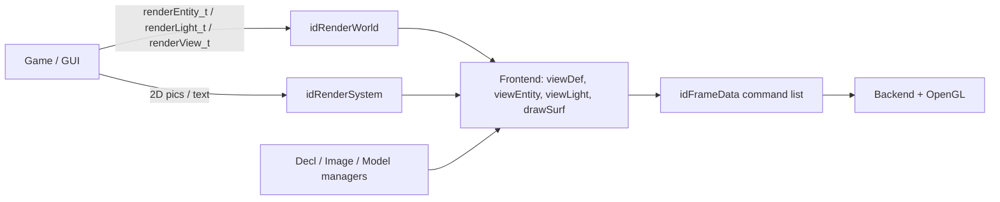

# 渲染架构：场景定义与前后端边界

本页是渲染子树的父页面。核心问题是：游戏层提交的不是 OpenGL 调用，而是实体、光源和视图定义；渲染前端再把它们转成后端可独立消费的帧数据。具体时序见[渲染帧流水线](07-render-frame.md)，资源编译见[材质、图像与着色器](08-materials-images.md)，场景筛选见[可见性与光照](09-visibility-lighting.md)。

## 两级公开接口

`idRenderSystem` 负责设备、帧命令缓冲、2D 绘制、截图、图像上传以及 `idRenderWorld` 的创建/释放；`idRenderWorld` 负责某一场景的地图、实体、光源、decal/overlay 和 portal 状态。[neo/renderer/RenderSystem.h:175-217](https://github.com/id-Software/DOOM-3-BFG/blob/1caba1979589971b5ed44e315d9ead30b278d8b4/neo/renderer/RenderSystem.h#L175-L217) [neo/renderer/RenderWorld.h:273-335](https://github.com/id-Software/DOOM-3-BFG/blob/1caba1979589971b5ed44e315d9ead30b278d8b4/neo/renderer/RenderWorld.h#L273-L335)

`Common` 在启动时只分配一个主 `renderWorld`，供游戏与 demo 重用；地图加载通过 `InitFromMap` 重置其内容，而不是每次另建一套渲染系统。[neo/framework/Common.cpp:1131-1138](https://github.com/id-Software/DOOM-3-BFG/blob/1caba1979589971b5ed44e315d9ead30b278d8b4/neo/framework/Common.cpp#L1131-L1138) `InitFromMap` 优先尝试 `generated/*.bproc`，包含模型、阴影模型、区域 portal 和节点；没有有效二进制结果时才走文本 `.proc` 解析。[neo/renderer/RenderWorld_load.cpp:737-808](https://github.com/id-Software/DOOM-3-BFG/blob/1caba1979589971b5ed44e315d9ead30b278d8b4/neo/renderer/RenderWorld_load.cpp#L737-L808)

## 游戏侧状态不是 draw call

游戏通过 `AddEntityDef/UpdateEntityDef` 和对应 Light API 提交定义。接口注释明确指出，大部分更新工作会推迟到确定某个视图真正需要它时执行。[neo/renderer/RenderWorld.h:286-303](https://github.com/id-Software/DOOM-3-BFG/blob/1caba1979589971b5ed44e315d9ead30b278d8b4/neo/renderer/RenderWorld.h#L286-L303)

实体 handle 是 `entityDefs` 数组索引，空槽会复用。`UpdateEntityDef` 校验模型或回调、必要时扩展数组，并把 `renderEntity_t` 值复制到 `def->parms`；但模型、关节、回调等指针仍由更高层生命周期约束，这不是深拷贝整个模型。[neo/renderer/RenderWorld.cpp:215-228](https://github.com/id-Software/DOOM-3-BFG/blob/1caba1979589971b5ed44e315d9ead30b278d8b4/neo/renderer/RenderWorld.cpp#L215-L228) [neo/renderer/RenderWorld.cpp:241-267](https://github.com/id-Software/DOOM-3-BFG/blob/1caba1979589971b5ed44e315d9ead30b278d8b4/neo/renderer/RenderWorld.cpp#L241-L267) [neo/renderer/RenderWorld.cpp:292-328](https://github.com/id-Software/DOOM-3-BFG/blob/1caba1979589971b5ed44e315d9ead30b278d8b4/neo/renderer/RenderWorld.cpp#L292-L328)

更新还有三个重要优化/边界：

- 无关节、无回调数据、无动态模型且结构完全相同，可直接返回。
- 仅回调参数变化而 bounds/origin/axis/model 未变时，只清理动态模型和交互表面，保留区域引用。
- 模型变化会释放派生数据；模型不变时允许保留 decals，最后按模型 bounds 重建区域引用。

以上分支由同一函数实现，不应把“UpdateEntityDef 总是重建全部渲染数据”作为修改前提。[neo/renderer/RenderWorld.cpp:263-297](https://github.com/id-Software/DOOM-3-BFG/blob/1caba1979589971b5ed44e315d9ead30b278d8b4/neo/renderer/RenderWorld.cpp#L263-L297) [neo/renderer/RenderWorld.cpp:315-328](https://github.com/id-Software/DOOM-3-BFG/blob/1caba1979589971b5ed44e315d9ead30b278d8b4/neo/renderer/RenderWorld.cpp#L315-L328)

## 初始化建立的是管理器集合

`idRenderSystemLocal::Init` 初始化 CVar/命令、GUI model、图像、cinematic、材质、模型管理器和前端作业列表，并通过一次 `SwapCommandBuffers` 准备命令缓冲。OpenGL 上下文初始化则在此前的 `InitOpenGL` 阶段完成。[neo/renderer/RenderSystem_init.cpp:2137-2194](https://github.com/id-Software/DOOM-3-BFG/blob/1caba1979589971b5ed44e315d9ead30b278d8b4/neo/renderer/RenderSystem_init.cpp#L2137-L2194) [neo/framework/Common.cpp:1048-1059](https://github.com/id-Software/DOOM-3-BFG/blob/1caba1979589971b5ed44e315d9ead30b278d8b4/neo/framework/Common.cpp#L1048-L1059)

图依据：场景公开 API 见上；`RenderScene` 在帧内存创建 `viewDef` 并调用 `R_RenderView`，[RenderWorld.cpp:782-858](https://github.com/id-Software/DOOM-3-BFG/blob/1caba1979589971b5ed44e315d9ead30b278d8b4/neo/renderer/RenderWorld.cpp#L782-L858)；前后端数据结构和命令链表定义于 [tr_local.h:461-544](https://github.com/id-Software/DOOM-3-BFG/blob/1caba1979589971b5ed44e315d9ead30b278d8b4/neo/renderer/tr_local.h#L461-L544)。

## 每帧快照的数据结构

`viewDef_t` 聚合一个视图的投影、viewport/scissor、frustum、draw surfaces、view lights/entities 以及区域连通信息。`viewLight_t` 和 `viewEntity_t` 是帧临时对象，源码特别说明它们用于隔离前端正在修改的持久定义。[neo/renderer/tr_local.h:273-278](https://github.com/id-Software/DOOM-3-BFG/blob/1caba1979589971b5ed44e315d9ead30b278d8b4/neo/renderer/tr_local.h#L273-L278) [neo/renderer/tr_local.h:366-426](https://github.com/id-Software/DOOM-3-BFG/blob/1caba1979589971b5ed44e315d9ead30b278d8b4/neo/renderer/tr_local.h#L366-L426)

`drawSurf_t` 是前端交给后端的表面命令：它保存索引/顶点/阴影/关节缓存 handle、变换空间、材质、额外 GL 状态、排序键、shader registers 和 scissor，而不是直接保存一次固定 OpenGL 调用。注释要求这些结构每帧重新分配，且后端不应读取可能仍被前端更新的 `frontEndGeo`。[neo/renderer/tr_local.h:91-116](https://github.com/id-Software/DOOM-3-BFG/blob/1caba1979589971b5ed44e315d9ead30b278d8b4/neo/renderer/tr_local.h#L91-L116)

这解释了为什么不能把 `drawSurf_t` 或 `viewDef_t` 缓存为跨帧稳定场景对象：它们属于某个帧快照；跨帧状态应留在 entity/light defs、模型/图像管理器或显式缓存中。

## RenderScene 生成什么

`RenderScene` 复制公开 `renderView_t`，在帧分配器上创建 `viewDef_t`，设置分辨率缩放、viewport/scissor、初始位置和镜像标志，再进入 `R_RenderView`；返回前还追加后处理命令。[neo/renderer/RenderWorld.cpp:787-861](https://github.com/id-Software/DOOM-3-BFG/blob/1caba1979589971b5ed44e315d9ead30b278d8b4/neo/renderer/RenderWorld.cpp#L787-L861)

`R_RenderView` 的顺序是：建立 view/projection 矩阵和 frustum，找可见灯光/实体，等待旧阴影任务，执行 `R_AddLights`、`R_AddModels`，加入游戏内 GUI，优化和排序 surfaces，递归生成子视图，最后追加 draw-view 命令。[neo/renderer/tr_frontend_main.cpp:354-420](https://github.com/id-Software/DOOM-3-BFG/blob/1caba1979589971b5ed44e315d9ead30b278d8b4/neo/renderer/tr_frontend_main.cpp#L354-L420)

镜子、远程画面和 GUI 内 3D 视图都能产生额外套嵌视图；因此“一次玩家相机 RenderScene 等于一条 draw 命令”不成立。公开接口也明确允许一个 scene 产生多个子视图。[neo/renderer/RenderWorld.h:326-335](https://github.com/id-Software/DOOM-3-BFG/blob/1caba1979589971b5ed44e315d9ead30b278d8b4/neo/renderer/RenderWorld.h#L326-L335)

## 后端契约与所有权

`idFrameData` 包含帧内存和命令链，注释要求后端所需的一切都在其中，并为 SMP 复制整套结构。[neo/renderer/tr_local.h:527-544](https://github.com/id-Software/DOOM-3-BFG/blob/1caba1979589971b5ed44e315d9ead30b278d8b4/neo/renderer/tr_local.h#L527-L544) `RenderCommandBuffers` 的公开契约进一步禁止后端引用“当前 frameData”，因为它可能已经在构建下一帧。[neo/renderer/RenderSystem.h:265-283](https://github.com/id-Software/DOOM-3-BFG/blob/1caba1979589971b5ed44e315d9ead30b278d8b4/neo/renderer/RenderSystem.h#L265-L283)

前端使用 `R_FrameAlloc` 分配视图、动态 tessellation 和命令；分配器以原子加法切分帧内存并做 cache-line 清零，越界则报错。注释规定后端不应分配这类内存。[neo/renderer/tr_frontend_main.cpp:126-163](https://github.com/id-Software/DOOM-3-BFG/blob/1caba1979589971b5ed44e315d9ead30b278d8b4/neo/renderer/tr_frontend_main.cpp#L126-L163)

因此，新增渲染特性的正确落点通常是：

1. 跨帧场景输入：扩展 entity/light 定义及其生命周期；
2. 每视图选择或派生：扩展前端 `viewDef/viewLight/viewEntity/drawSurf`；
3. GPU 执行：扩展命令结构和后端解释器；
4. 帧间共享数据：使用明确的缓存管理器，而不是借用当前帧内存。

返回[总入口](index.md)。
