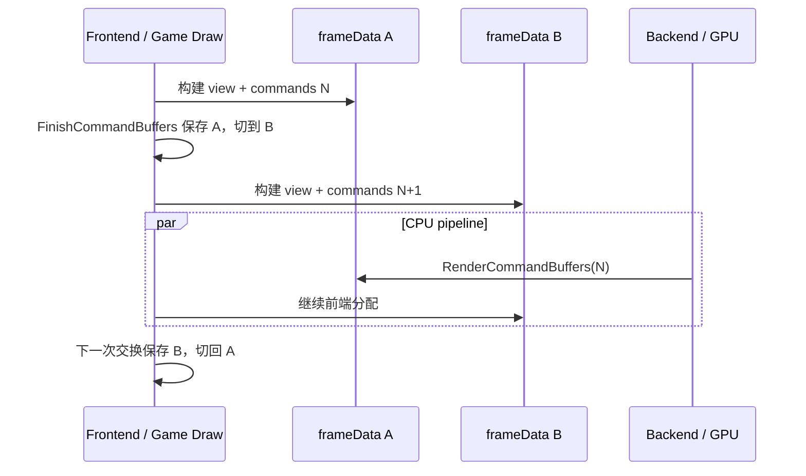

# 渲染帧流水线：命令缓冲、SMP 与后端阶段

本页接续[渲染架构](06-render-architecture.md)，解释一条 `viewDef` 如何进入命令链、双份帧内存如何轮转，以及后端实际按什么顺序绘制。外层 `Common::Frame` 的游戏线程交接见[启动与帧循环](03-startup-frame.md)。

## 前端把视图追加为命令

`R_RenderView` 完成场景筛选、灯光/模型处理和子视图后，调用 `R_AddDrawViewCmd`。后者从当前 `frameData` 分配 `drawSurfsCommand_t`，按 3D/GUI 设置命令类型并保存 `viewDef` 指针；后处理则追加 `RC_POST_PROCESS`。[neo/renderer/tr_frontend_main.cpp:406-423](https://github.com/id-Software/DOOM-3-BFG/blob/1caba1979589971b5ed44e315d9ead30b278d8b4/neo/renderer/tr_frontend_main.cpp#L406-L423) [neo/renderer/RenderSystem.cpp:168-200](https://github.com/id-Software/DOOM-3-BFG/blob/1caba1979589971b5ed44e315d9ead30b278d8b4/neo/renderer/RenderSystem.cpp#L168-L200)

所有命令通过 `R_GetCommandBuffer` 从帧内存分配并链接到 `cmdTail`。当前命令类型包括 NOP、3D view、GUI view、set buffer、copy render 和 post process。[neo/renderer/RenderSystem.cpp:134-151](https://github.com/id-Software/DOOM-3-BFG/blob/1caba1979589971b5ed44e315d9ead30b278d8b4/neo/renderer/RenderSystem.cpp#L134-L151) [neo/renderer/tr_local.h:461-503](https://github.com/id-Software/DOOM-3-BFG/blob/1caba1979589971b5ed44e315d9ead30b278d8b4/neo/renderer/tr_local.h#L461-L503)

## 双份帧数据的轮转

本快照固定使用两份 `idFrameData`，每份预分配 64 MiB，单块分配按 128 字节对齐。[neo/renderer/tr_frontend_main.cpp:42-48](https://github.com/id-Software/DOOM-3-BFG/blob/1caba1979589971b5ed44e315d9ead30b278d8b4/neo/renderer/tr_frontend_main.cpp#L42-L48) [neo/renderer/tr_frontend_main.cpp:113-123](https://github.com/id-Software/DOOM-3-BFG/blob/1caba1979589971b5ed44e315d9ead30b278d8b4/neo/renderer/tr_frontend_main.cpp#L113-L123)

`SwapCommandBuffers_FinishCommandBuffers` 做以下交接：

1. 关闭 GUI 绘制并调用 `vertexCache.BeginBackEnd()`，解除映射供 GPU 使用。
2. 保存当前命令头，复制后端需要的内建 surface 引用。
3. `R_ToggleSmpFrame()` 切换到另一份帧内存。
4. 新帧重新建立 GUI、内建几何、render crop 和帧计数。

这些步骤直接保证旧命令及其 `viewDef/drawSurf` 留在旧帧内存，新前端不会立即覆盖它们。[neo/renderer/RenderSystem.cpp:691-738](https://github.com/id-Software/DOOM-3-BFG/blob/1caba1979589971b5ed44e315d9ead30b278d8b4/neo/renderer/RenderSystem.cpp#L691-L738) `R_ToggleSmpFrame` 自身负责记录高水位、轮转索引、重置分配位置，并放入初始 `RC_NOP`。[neo/renderer/tr_frontend_main.cpp:62-93](https://github.com/id-Software/DOOM-3-BFG/blob/1caba1979589971b5ed44e315d9ead30b278d8b4/neo/renderer/tr_frontend_main.cpp#L62-L93)

图依据：双份帧数据和交换实现见上。该图表达 CPU 数据所有权，不表示 GPU 可无限排队。

## 与 Common 帧循环组合后的时序

完整 `SwapCommandBuffers` 由两部分组成：先 `FinishRendering` 等待上一 GPU 工作并收集计时，再 `FinishCommandBuffers` 保存并轮转命令缓冲。[neo/renderer/RenderSystem.cpp:598-620](https://github.com/id-Software/DOOM-3-BFG/blob/1caba1979589971b5ed44e315d9ead30b278d8b4/neo/renderer/RenderSystem.cpp#L598-L620)

SMP 模式下，`Common` 在帧首完成交换，然后让 Game/Draw 构建新命令，同时把刚关闭的旧命令交给 `RenderCommandBuffers`。非 SMP 模式把交换拆开：帧首只完成上一 GPU 工作，游戏/绘制在主线程同步完成后才关闭当前命令并立即执行。[neo/framework/common_frame.cpp:430-440](https://github.com/id-Software/DOOM-3-BFG/blob/1caba1979589971b5ed44e315d9ead30b278d8b4/neo/framework/common_frame.cpp#L430-L440) [neo/framework/common_frame.cpp:622-645](https://github.com/id-Software/DOOM-3-BFG/blob/1caba1979589971b5ed44e315d9ead30b278d8b4/neo/framework/common_frame.cpp#L622-L645)

GPU 侧还有显式节流：`GL_BlockingSwapBuffers` 在 sync 不可用时 `glFinish`，可用时交换缓冲、建立 fence，并等待选定 sync。`r_syncEveryFrame` 默认开启时等待当前 swap 后的 fence，否则等待另一份。[neo/renderer/OpenGL/gl_backend.cpp:113-166](https://github.com/id-Software/DOOM-3-BFG/blob/1caba1979589971b5ed44e315d9ead30b278d8b4/neo/renderer/OpenGL/gl_backend.cpp#L113-L166) [neo/renderer/OpenGL/gl_backend.cpp:45-49](https://github.com/id-Software/DOOM-3-BFG/blob/1caba1979589971b5ed44e315d9ead30b278d8b4/neo/renderer/OpenGL/gl_backend.cpp#L45-L49) 因而“双 frameData”解决的是前端/后端 CPU 数据竞争，不应被解释为无界 GPU 异步。

## RenderCommandBuffers 的入口保护

后端入口先扫描链中是否存在 3D 或 GUI view；没有 view 就直接返回，避免交换一帧没有有效画面的缓冲。存在 view 时，在 timer query 可用的情况下包住整个命令执行并 `qglFlush`，否则直接执行。[neo/renderer/RenderSystem.cpp:95-131](https://github.com/id-Software/DOOM-3-BFG/blob/1caba1979589971b5ed44e315d9ead30b278d8b4/neo/renderer/RenderSystem.cpp#L95-L131)

`RB_ExecuteBackEndCommands` 设置默认 GL 状态后顺序解释命令：`RC_DRAW_VIEW_*` 进入 `RB_DrawView`，`RC_COPY_RENDER` 复制帧缓冲，`RC_POST_PROCESS` 进入后处理；未知命令触发引擎错误。[neo/renderer/OpenGL/gl_backend.cpp:503-558](https://github.com/id-Software/DOOM-3-BFG/blob/1caba1979589971b5ed44e315d9ead30b278d8b4/neo/renderer/OpenGL/gl_backend.cpp#L503-L558)

## 单个 view 的后端顺序

`RB_DrawView` 把命令中的 `viewDef` 设为后端当前视图，跳过空 surface 列表，调用 `RB_DrawViewInternal`，随后处理 motion blur。[neo/renderer/tr_backend_draw.cpp:2748-2783](https://github.com/id-Software/DOOM-3-BFG/blob/1caba1979589971b5ed44e315d9ead30b278d8b4/neo/renderer/tr_backend_draw.cpp#L2748-L2783)

主要 3D/GUI 绘制阶段为：

| 顺序 | 阶段 | 关键行为 |
| --- | --- | --- |
| 1 | 资源与状态准备 | 确保材质未 purged，设置 viewport/scissor，清 depth/stencil，写全局 shader 参数 |
| 2 | Depth pre-pass | `RB_FillDepthBufferFast` |
| 3 | 灯光交互 | `RB_DrawInteractions` |
| 4 | 非灯光材质阶段 | `RB_DrawShaderPasses` |
| 5 | Fog / blend lights | `RB_FogAllLights` |
| 6 | 屏幕后处理 | 必要时复制 `_currentRender`，处理剩余 surfaces |
| 7 | 调试绘制 | `RB_RenderDebugTools` |

表依据：[tr_backend_draw.cpp:2457-2555](https://github.com/id-Software/DOOM-3-BFG/blob/1caba1979589971b5ed44e315d9ead30b278d8b4/neo/renderer/tr_backend_draw.cpp#L2457-L2555) 与 [tr_backend_draw.cpp:2557-2634](https://github.com/id-Software/DOOM-3-BFG/blob/1caba1979589971b5ed44e315d9ead30b278d8b4/neo/renderer/tr_backend_draw.cpp#L2557-L2634)。

后端在绘制前对 surface 材质调用 `EnsureNotPurged`，注释说明该操作从 GUI emit 移到这里，是为了避免分离线程尝试加载图像。[neo/renderer/tr_backend_draw.cpp:2457-2473](https://github.com/id-Software/DOOM-3-BFG/blob/1caba1979589971b5ed44e315d9ead30b278d8b4/neo/renderer/tr_backend_draw.cpp#L2457-L2473) 这与[声明的主线程惰性解析约束](05-files-declarations.md)相呼应：新增资源加载时，必须确认它落在哪个线程和哪个阶段。

## 修改流水线的约束

- 新命令必须同时具备帧内存结构、命令枚举、入队函数和后端 switch 分支；只添加结构不会执行。
- 后端只能读取已关闭帧的数据，不能访问全局“当前 frameData”或可能被下一前端改写的 `frontEndGeo`。[neo/renderer/RenderSystem.h:280-283](https://github.com/id-Software/DOOM-3-BFG/blob/1caba1979589971b5ed44e315d9ead30b278d8b4/neo/renderer/RenderSystem.h#L280-L283) [neo/renderer/tr_local.h:99-108](https://github.com/id-Software/DOOM-3-BFG/blob/1caba1979589971b5ed44e315d9ead30b278d8b4/neo/renderer/tr_local.h#L99-L108)
- 后处理需要当前颜色/深度时，应遵循已有 copy 命令和 `_currentRender` 生命周期，不能假设前帧内容仍可读。
- 改变 pass 顺序时，同时检查 depth equality、stencil、透明 surface、子视图和 motion blur 的依赖，而不是只验证主相机。

返回[总入口](index.md)。
