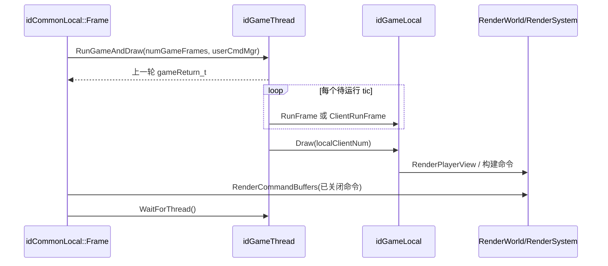

# 游戏运行时：Session、Game 与地图生命周期

本页是游戏层父页面，解释外层会话如何创建一张可运行地图，`idGame` 如何推进模拟并生成画面。实体、脚本、物理、网络等细节分别见[实体与地图](11-entities-map.md)、[事件与脚本](12-events-script.md)、[物理与碰撞](13-physics-collision.md)和[网络会话](16-network-session.md)。

## 关键源码

- `neo/sys/sys_session.h`、`sys_session_local.h`：公共会话状态和内部细分状态。
- `neo/framework/Common_load.cpp`：地图切换的组合根。
- `neo/framework/common_frame.cpp`：Game/Draw 工作线程与 `gameReturn_t`。
- `neo/d3xp/Game.h`、`Game_local.cpp`：引擎/游戏契约及其实现。

## 两层状态与接口边界

`idSession` 对外暴露 `PRESS_START`、lobby、`LOADING`、`INGAME` 等粗粒度状态；`idSessionLocal` 另分 host/peer、创建并迁移 lobby 等内部状态，并把 `STATE_LOADING`、`STATE_INGAME` 放在末尾以支持 `>= STATE_LOADING` 判断。[neo/sys/sys_session.h:355-369](https://github.com/id-Software/DOOM-3-BFG/blob/1caba1979589971b5ed44e315d9ead30b278d8b4/neo/sys/sys_session.h#L355-L369) [neo/sys/sys_session_local.h:138-160](https://github.com/id-Software/DOOM-3-BFG/blob/1caba1979589971b5ed44e315d9ead30b278d8b4/neo/sys/sys_session_local.h#L138-L160) 因此游戏逻辑不应把 lobby 菜单状态误当成地图已生成。

`idGame` 契约覆盖一次性 `Init/Shutdown`、新地图/存档初始化、地图关闭、`RunFrame`、客户端预测、`Draw`、snapshot 和 reliable message。[neo/d3xp/Game.h:64-108](https://github.com/id-Software/DOOM-3-BFG/blob/1caba1979589971b5ed44e315d9ead30b278d8b4/neo/d3xp/Game.h#L64-L108) [neo/d3xp/Game.h:115-135](https://github.com/id-Software/DOOM-3-BFG/blob/1caba1979589971b5ed44e315d9ead30b278d8b4/neo/d3xp/Game.h#L115-L135) 当前静态配置中 `game` 直接指向全局 `gameLocal`；`Common` 的 `LoadGameDLL` 只有在 `__DOOM_DLL__` 下才查找库并验证 `GAME_API_VERSION`，两种路径最后都调用同一个 `game->Init()`。[neo/d3xp/Game_local.cpp:62-64](https://github.com/id-Software/DOOM-3-BFG/blob/1caba1979589971b5ed44e315d9ead30b278d8b4/neo/d3xp/Game_local.cpp#L62-L64) [neo/framework/Common.cpp:819-880](https://github.com/id-Software/DOOM-3-BFG/blob/1caba1979589971b5ed44e315d9ead30b278d8b4/neo/framework/Common.cpp#L819-L880) 构建形态见[构建与平台](02-build-platform.md)。

`idGameLocal::Init` 每次进程启动只执行一次：注册游戏 decl 类型/目录，初始化事件和类系统，创建 shell，启动默认 script program，并按 `aas_types` 分配 AAS 对象；地图加载是之后的独立生命周期。[neo/d3xp/Game_local.cpp:275-325](https://github.com/id-Software/DOOM-3-BFG/blob/1caba1979589971b5ed44e315d9ead30b278d8b4/neo/d3xp/Game_local.cpp#L275-L325) [neo/d3xp/Game_local.cpp:327-363](https://github.com/id-Software/DOOM-3-BFG/blob/1caba1979589971b5ed44e315d9ead30b278d8b4/neo/d3xp/Game_local.cpp#L327-L363)

## ExecuteMapChange 的组合顺序

`ExecuteMapChange` 要求会话处于 `LOADING` 且 slot 数有效，保存 `loadingID` 以识别加载期间的新请求，然后从 match parameters 得到地图和模式。[neo/framework/Common_load.cpp:383-410](https://github.com/id-Software/DOOM-3-BFG/blob/1caba1979589971b5ed44e315d9ead30b278d8b4/neo/framework/Common_load.cpp#L383-L410) 它先复位平台/输入/音频和帧率约束，再让 `renderWorld->InitFromMap("maps/<name>.map")` 加载几何；随后按是否存在 savegame file 走 `InitFromSaveGame` 或 `InitFromNewMap`。[neo/framework/Common_load.cpp:490-521](https://github.com/id-Software/DOOM-3-BFG/blob/1caba1979589971b5ed44e315d9ead30b278d8b4/neo/framework/Common_load.cpp#L490-L521) [neo/framework/Common_load.cpp:527-542](https://github.com/id-Software/DOOM-3-BFG/blob/1caba1979589971b5ed44e315d9ead30b278d8b4/neo/framework/Common_load.cpp#L527-L542)

新地图路径在 `idGameLocal` 中保存 `gameRenderWorld/gameSoundWorld`，执行 `LoadMap`、地图脚本初始化、`MapPopulate`，重置并预缓存多人规则，最后进入 `GAMESTATE_ACTIVE`。[neo/d3xp/Game_local.cpp:1168-1205](https://github.com/id-Software/DOOM-3-BFG/blob/1caba1979589971b5ed44e315d9ead30b278d8b4/neo/d3xp/Game_local.cpp#L1168-L1205)

实体生成后还有三项不可省略的收尾：

- 新地图先运行一个空 usercmd 帧，以捕获 spawn 事件引用的资源，再结束 render/sound/decl/UI/file system 的 level-load 阶段。[neo/framework/Common_load.cpp:562-580](https://github.com/id-Software/DOOM-3-BFG/blob/1caba1979589971b5ed44e315d9ead30b278d8b4/neo/framework/Common_load.cpp#L562-L580)
- 非多人、非读档新地图再运行 100 个游戏帧以稳定 ragdoll，并写 autosave。[neo/framework/Common_load.cpp:582-598](https://github.com/id-Software/DOOM-3-BFG/blob/1caba1979589971b5ed44e315d9ead30b278d8b4/neo/framework/Common_load.cpp#L582-L598)
- 所有实体就位后调用 `GenerateAllInteractions` 预建渲染交互；最终只有会话仍为 `INGAME` 等收尾条件满足时才设置 `mapSpawned = true`。[neo/framework/Common_load.cpp:600-648](https://github.com/id-Software/DOOM-3-BFG/blob/1caba1979589971b5ed44e315d9ead30b278d8b4/neo/framework/Common_load.cpp#L600-L648)

`MapShutdown` 则清理地图对象、脚本、粒子、PVS、clip/collision map 和异步网络，卸载地图资源，并把两个 world 指针及 game state 复位。[neo/d3xp/Game_local.cpp:1497-1550](https://github.com/id-Software/DOOM-3-BFG/blob/1caba1979589971b5ed44e315d9ead30b278d8b4/neo/d3xp/Game_local.cpp#L1497-L1550) 新系统若持有地图资源，必须加入对称的生命周期，而不是依赖进程退出。

## Game/Draw 工作单元

`idGameThread::RunGameAndDraw` 先等待上一轮结束，锁存上一轮的 `gameReturn_t`，再按 `com_smp` 选择直接 `Run()` 或 `SignalWork()`；返回值属于上一轮，而新一轮可在后台继续。[neo/framework/common_frame.cpp:155-178](https://github.com/id-Software/DOOM-3-BFG/blob/1caba1979589971b5ed44e315d9ead30b278d8b4/neo/framework/common_frame.cpp#L155-L178) 这与[外层帧和渲染命令缓冲](03-startup-frame.md)的流水关系一致。

每次 `Run()` 对 server/host 循环调用 `game->RunFrame`，对 client 调用 `ClientRunFrame`；`syncNextGameFrame` 或 session command 会提前停止补 tic。模拟后统一执行 `commonLocal.Draw()` 构建渲染命令。[neo/framework/common_frame.cpp:86-120](https://github.com/id-Software/DOOM-3-BFG/blob/1caba1979589971b5ed44e315d9ead30b278d8b4/neo/framework/common_frame.cpp#L86-L120) [neo/framework/common_frame.cpp:123-146](https://github.com/id-Software/DOOM-3-BFG/blob/1caba1979589971b5ed44e315d9ead30b278d8b4/neo/framework/common_frame.cpp#L123-L146)

图依据：工作提交与锁存见 `common_frame.cpp:155-178`，tic/Draw 见 `common_frame.cpp:86-146`，主循环提交与等待见[common_frame.cpp:622-645](https://github.com/id-Software/DOOM-3-BFG/blob/1caba1979589971b5ed44e315d9ead30b278d8b4/neo/framework/common_frame.cpp#L622-L645)。图中 server/client 是条件分支，不会在同一工作单元中同时执行。

## 一个服务端游戏 tic

`idGameLocal::RunFrame` 在没有 `gameRenderWorld` 时直接返回。正常路径推进 fast/slow 时间，处理网络事件、重力和玩家 PVS，排序 active entity 链，然后按 time group 运行实体 think；之后清理失活实体，服务普通/fast event，释放 PVS，运行多人规则并构造返回值。[neo/d3xp/Game_local.cpp:2256-2305](https://github.com/id-Software/DOOM-3-BFG/blob/1caba1979589971b5ed44e315d9ead30b278d8b4/neo/d3xp/Game_local.cpp#L2256-L2305) [neo/d3xp/Game_local.cpp:2341-2367](https://github.com/id-Software/DOOM-3-BFG/blob/1caba1979589971b5ed44e315d9ead30b278d8b4/neo/d3xp/Game_local.cpp#L2341-L2367) [neo/d3xp/Game_local.cpp:2409-2454](https://github.com/id-Software/DOOM-3-BFG/blob/1caba1979589971b5ed44e315d9ead30b278d8b4/neo/d3xp/Game_local.cpp#L2409-L2454)

`gameReturn_t` 不是直接线程安全的消息队列：`BuildReturnValue` 从 game state 拷贝震动和 session command，并清除 `sessionCommand` 以避免 SMP 下重复切图。[neo/d3xp/Game_local.cpp:2473-2488](https://github.com/id-Software/DOOM-3-BFG/blob/1caba1979589971b5ed44e315d9ead30b278d8b4/neo/d3xp/Game_local.cpp#L2473-L2488) 主线程随后把 `map/devmap/died/disconnect/endOfDemo` 转为会话或命令系统操作。[neo/framework/common_frame.cpp:327-357](https://github.com/id-Software/DOOM-3-BFG/blob/1caba1979589971b5ed44e315d9ead30b278d8b4/neo/framework/common_frame.cpp#L327-L357)

普通单机 `Draw` 要求有效本地 player 和 renderView，再调用 `playerView.RenderPlayerView`；多人 `INGAME` 则委托 `mpGame.Draw`，无效 client 或 view 返回 false，由 `Common` 绘制替代画面。[neo/d3xp/Game_local.cpp:2710-2732](https://github.com/id-Software/DOOM-3-BFG/blob/1caba1979589971b5ed44e315d9ead30b278d8b4/neo/d3xp/Game_local.cpp#L2710-L2732) [neo/framework/common_frame.cpp:249-264](https://github.com/id-Software/DOOM-3-BFG/blob/1caba1979589971b5ed44e315d9ead30b278d8b4/neo/framework/common_frame.cpp#L249-L264)

## 修改约束

- 游戏层新增的每 tic 全局状态要考虑一次外层帧可能运行多个 tic，以及 SMP 下返回值的上一轮语义。
- 新地图资源需要同时接入 preload、shutdown 和 savegame 分支；只改 `InitFromNewMap` 会留下读档差异。
- 在 `Draw` 中不要推进权威玩法状态；它位于模拟之后并负责构建呈现命令。
- 会话命令应由主线程消费，不要在 game thread 内直接重入 `ExecuteMapChange`。

返回[总入口](index.md)。
