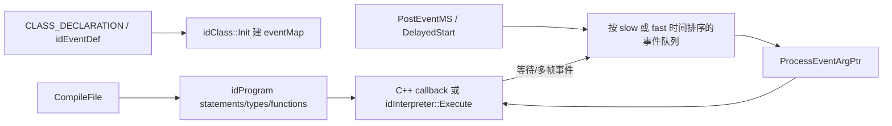

# 类系统、事件与脚本 VM

本页解释[实体生成](11-entities-map.md)背后的动态类型和事件机制，以及地图/游戏脚本如何编译并在多个游戏 tic 中恢复执行。这里的 `idThread` 是脚本协程，不是[作业系统](04-idlib-jobs.md)或 Game/Draw 的 OS 线程。

## 关键源码

- `neo/d3xp/gamesys/Class.*`：单继承 RTTI、实例创建、event callback 表。
- `neo/d3xp/gamesys/Event.*`：事件定义、参数存储、排序队列和服务循环。
- `neo/d3xp/script/Script_Program.cpp`、`Script_Compiler.cpp`：程序编译与地图重启动。
- `neo/d3xp/script/Script_Interpreter.cpp`、`Script_Thread.cpp`：VM 与协作式脚本线程。

## 静态宏形成运行时类型图

类声明中的 `CLASS_PROTOTYPE` 提供静态 `Type`、`CreateInstance`、`GetType` 和 event callback 数组；实现文件中的 `CLASS_DECLARATION(super, class)` 初始化 `idTypeInfo`，保存父类名、spawn/save/restore 和创建函数，并打开 `EVENT(...)` 映射表。[neo/d3xp/gamesys/Class.h:85-127](../../_src/DOOM-3-BFG/neo/d3xp/gamesys/Class.h#L85-L127)

`idTypeInfo` 静态构造把类型按名称插入链表，并处理“子类静态初始化早于父类”的连接情况。[neo/d3xp/gamesys/Class.cpp:55-106](../../_src/DOOM-3-BFG/neo/d3xp/gamesys/Class.cpp#L55-L106) `idClass::Init` 再初始化所有 event map、按层次编号类型，并建立名称和 typeNum 索引。[neo/d3xp/gamesys/Class.cpp:378-419](../../_src/DOOM-3-BFG/neo/d3xp/gamesys/Class.cpp#L378-L419)

event map 按继承链从当前类向父类扫描，同一 event 只采用第一次遇到的 callback，因此子类覆盖父类；完全没有新增 callback 的类型可直接共享父表。[neo/d3xp/gamesys/Class.cpp:125-159](../../_src/DOOM-3-BFG/neo/d3xp/gamesys/Class.cpp#L125-L159) [neo/d3xp/gamesys/Class.cpp:156-199](../../_src/DOOM-3-BFG/neo/d3xp/gamesys/Class.cpp#L156-L199) `ProcessEventArgPtr` 从对象的实际 `GetType()` 取表，找不到事件返回 false；实体调用前还会切换至其 time group。[neo/d3xp/gamesys/Class.cpp:898-925](../../_src/DOOM-3-BFG/neo/d3xp/gamesys/Class.cpp#L898-L925)

## 事件定义与参数所有权

`idEventDef(name, formatspec, returnType)` 在静态初始化期记录参数个数、格式和每个参数在事件数据块中的 offset；参数数超过 `D_EVENT_MAXARGS` 或格式非法会留下 event error，由 `idEvent::Init` 报出。[neo/d3xp/gamesys/Event.cpp:61-120](../../_src/DOOM-3-BFG/neo/d3xp/gamesys/Event.cpp#L61-L120) [neo/d3xp/gamesys/Event.cpp:689-715](../../_src/DOOM-3-BFG/neo/d3xp/gamesys/Event.cpp#L689-L715)

延迟事件不是保存调用方的参数指针：vector/string/trace 被复制进事件数据，entity 以 `idEntityPtr` 保存，trace 的材质额外保存名称，供服务时重新查 decl。[neo/d3xp/gamesys/Event.cpp:281-324](../../_src/DOOM-3-BFG/neo/d3xp/gamesys/Event.cpp#L281-L324) 服务队列时再按 format 重建本地参数指针数组，然后从队列摘除节点、调用 `ProcessEventArgPtr` 并释放事件；单帧超过 `MAX_EVENTSPERFRAME` 被视为可能的脚本事件死循环。[neo/d3xp/gamesys/Event.cpp:502-580](../../_src/DOOM-3-BFG/neo/d3xp/gamesys/Event.cpp#L502-L580)

`Schedule` 将同一时间的事件按插入顺序排在已有节点之后。`TIME_GROUP2` 实体进入 `FastEventQueue`，时间基于 `gameLocal.time`；其他事件进入普通 `EventQueue`，时间基于 `gameLocal.slow.time`。[neo/d3xp/gamesys/Event.cpp:385-427](../../_src/DOOM-3-BFG/neo/d3xp/gamesys/Event.cpp#L385-L427) 两条队列分别由 `ServiceEvents` 与 `ServiceFastEvents` 服务，调用顺序位于[每个游戏 tic 的实体 think 之后](10-game-runtime.md)。

## 脚本程序的生命周期

`idProgram::Startup` 先清空旧脚本线程，进入 compilation，编译默认脚本并完成编译。[neo/d3xp/script/Script_Program.cpp:1899-1914](../../_src/DOOM-3-BFG/neo/d3xp/script/Script_Program.cpp#L1899-L1914) `CompileFile` 通过 file system 读取文本，再交给 `CompileText`；读取失败是游戏错误。[neo/d3xp/script/Script_Program.cpp:1825-1842](../../_src/DOOM-3-BFG/neo/d3xp/script/Script_Program.cpp#L1825-L1842)

`idCompiler::CompileFile` 在全局 namespace 解析源码，并预先压入 `#include SCRIPT_DEFAULTDEFS`，因此每份脚本都带默认定义。`CompileText` 还会检查需要函数体的 prototype，console 编译失败返回 false，非 console 编译失败走游戏错误。[neo/d3xp/script/Script_Compiler.cpp:2573-2624](../../_src/DOOM-3-BFG/neo/d3xp/script/Script_Compiler.cpp#L2573-L2624) [neo/d3xp/script/Script_Program.cpp:1762-1799](../../_src/DOOM-3-BFG/neo/d3xp/script/Script_Program.cpp#L1762-L1799)

地图关闭或重启动时，`idProgram::Restart` 删除所有脚本线程，只保留初始 `top_types/top_defs/top_functions/top_statements/top_files` 之前的程序内容，移除地图或 console 后续编译的定义，并恢复默认变量值。[neo/d3xp/script/Script_Program.cpp:2047-2085](../../_src/DOOM-3-BFG/neo/d3xp/script/Script_Program.cpp#L2047-L2085)

## VM 与协作式 `idThread`

`idInterpreter` 保存固定深度调用栈、字节 local stack、当前 function 和 instruction pointer。[neo/d3xp/script/Script_Interpreter.h:35-59](../../_src/DOOM-3-BFG/neo/d3xp/script/Script_Interpreter.h#L35-L59) `Execute` 逐条解释 statement，支持函数调用、native event/system call、对象调用和创建新脚本线程；单次执行有 5,000,000 次 runaway 限制。[neo/d3xp/script/Script_Interpreter.cpp:943-1015](../../_src/DOOM-3-BFG/neo/d3xp/script/Script_Interpreter.cpp#L943-L1015)

`idThread::DelayedStart` 并不 spawn OS 线程，而是给自身投递 `EV_Thread_Execute`；地图时间为 0 时额外延迟 1 ms。[neo/d3xp/script/Script_Thread.cpp:544-555](../../_src/DOOM-3-BFG/neo/d3xp/script/Script_Thread.cpp#L544-L555) 执行时 VM 返回 `done` 表示结束；未完成但设置了未来 `waitingUntil`，或 multi-frame event 仍在进行，会再次投递事件以恢复 instruction pointer。[neo/d3xp/script/Script_Thread.cpp:659-688](../../_src/DOOM-3-BFG/neo/d3xp/script/Script_Thread.cpp#L659-L688) `End` 只设置 pause 和 `threadDying`，让解释器自行退出。[neo/d3xp/script/Script_Thread.cpp:598-607](../../_src/DOOM-3-BFG/neo/d3xp/script/Script_Thread.cpp#L598-L607)

图依据：类型表见 `Class.cpp:125-199`，编译见 `Script_Program.cpp:1825-1842`，队列与 VM 恢复见 `Event.cpp:385-427`、`Script_Thread.cpp:659-688`。

## 修改约束

- 新事件必须统一 `idEventDef` 格式、C++ callback 签名和脚本声明；格式表决定 ABI 参数布局。
- 新实体类需要正确的单继承 `CLASS_PROTOTYPE/CLASS_DECLARATION`，否则创建、`IsType`、事件覆盖和存档函数表都会受影响。
- 长时间脚本应通过 wait/multi-frame 机制让出执行，不能依赖 runaway 限制作为正常调度。
- 修改脚本字节码布局后注意存档 checksum 与解释器状态恢复，详见[持久化](15-persistence.md)。

返回[游戏运行时](10-game-runtime.md)或[总入口](index.md)。
