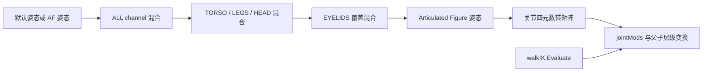

# 动画、IK 与 AI 导航

本页追踪角色从动画数据到最终骨架、再到每 tic 行为决策和导航的路径。它承接[实体更新](11-entities-map.md)、[脚本协程](12-events-script.md)与[碰撞查询](13-physics-collision.md)：动画可以触发脚本事件，AI 脚本可以选择移动目标，但实际位移和贴地仍受物理系统约束。

## 动画不是单纯播放剪辑

`idAnimator` 将模型关节划分为 `ALL`、`TORSO`、`LEGS`、`HEAD`、`EYELIDS` 五个 channel，每个 channel 最多保存三个正在混合的动画。channel 顺序也是脚本接口的一部分，增加或重排 channel 时必须同步 `doom_defs.script`。[neo/d3xp/anim/Anim.h:31-49](../../_src/DOOM-3-BFG/neo/d3xp/anim/Anim.h#L31-L49)

每个游戏更新中有两种不同工作：

- `ServiceAnims(fromtime, totime)` 跨越时间区间调用所有 channel 的 frame commands；动画停止后关闭 `TH_ANIMATE`，但额外激活一次 `TH_UPDATEVISUALS`，让渲染交互按停止后的姿态重建。[neo/d3xp/anim/Anim_Blend.cpp:4164-4189](../../_src/DOOM-3-BFG/neo/d3xp/anim/Anim_Blend.cpp#L4164-L4189)
- `CreateFrame(currentTime, force)` 计算某个时间点的关节姿态；相同时间且非强制更新时可以直接返回，因此它不是无条件重算函数。[neo/d3xp/anim/Anim_Blend.cpp:4261-4290](../../_src/DOOM-3-BFG/neo/d3xp/anim/Anim_Blend.cpp#L4261-L4290)

`CreateFrame` 先复制默认姿态；若存在 AF pose，则改用它作为缺省姿态。随后先混合 `ALL`，只有 `ALL` 的累计权重尚未达到 1 时才给其他 channel 留混合空间，眼睑最后叠加，AF pose 再参与，最后转换成关节矩阵。[neo/d3xp/anim/Anim_Blend.cpp:4300-4356](../../_src/DOOM-3-BFG/neo/d3xp/anim/Anim_Blend.cpp#L4300-L4356) [neo/d3xp/anim/Anim_Blend.cpp:4359-4385](../../_src/DOOM-3-BFG/neo/d3xp/anim/Anim_Blend.cpp#L4359-L4385)

关节修正不是简单遍历所有关节后统一覆盖。实现按 `jointMods` 排序位置分段：先变换修正项之前的父子层级，应用当前修正，再继续处理后续关节；根关节还单独叠加模型视觉偏移。没有动画更新且没有 `jointMods` 时，函数直接返回 `false`。[neo/d3xp/anim/Anim_Blend.cpp:4379-4439](../../_src/DOOM-3-BFG/neo/d3xp/anim/Anim_Blend.cpp#L4379-L4439) [neo/d3xp/anim/Anim_Blend.cpp:4434-4494](../../_src/DOOM-3-BFG/neo/d3xp/anim/Anim_Blend.cpp#L4434-L4494)

## Walk IK 如何修改骨架

`idActor::Spawn` 用 `IK_ANIM` 初始化 `walkIK`；非 ragdoll 更新时清除 AF pose，并在 IK 已初始化且 `ik_enable` 开启时调用 `walkIK.Evaluate()`。ragdoll 激活则走 `idAFEntity_Base` 的动画控制路径，不再叠加普通 walk IK。[neo/d3xp/Actor.cpp:538-546](../../_src/DOOM-3-BFG/neo/d3xp/Actor.cpp#L538-L546) [neo/d3xp/Actor.cpp:1710-1723](../../_src/DOOM-3-BFG/neo/d3xp/Actor.cpp#L1710-L1723) [neo/d3xp/IK.cpp:111-116](../../_src/DOOM-3-BFG/neo/d3xp/IK.cpp#L111-L116)

初始化从 `ik_numLegs` 决定腿数；零腿是可接受的无操作配置。否则解析每腿 foot、ankle、knee、hip 及可选方向关节和 waist，必需关节无效会触发 `gameLocal.Error`。实现还从指定动画第一帧建立骨架，缓存上下腿长度和骨骼轴转换，并读取平滑、腰部距离、上下探测距离等 spawn 参数。[neo/d3xp/IK.cpp:424-457](../../_src/DOOM-3-BFG/neo/d3xp/IK.cpp#L424-L457) [neo/d3xp/IK.cpp:461-531](../../_src/DOOM-3-BFG/neo/d3xp/IK.cpp#L461-L531) [neo/d3xp/IK.cpp:533-545](../../_src/DOOM-3-BFG/neo/d3xp/IK.cpp#L533-L545)

每次求值只在新游戏帧且至少一腿启用时执行，顺序为：

1. 先用**不带 joint mods** 的当前动画帧读取脚底位置；可选 pivot 逻辑固定支撑脚，减少脚步滑动。
2. 对每只启用的脚，以 `CONTENTS_SOLID | CONTENTS_IKCLIP` 做上下范围的 trace，取得地面高度。
3. 只有物理对象有地面接触时才把脚踝向地面调整；站在平台上时不做常规历史平滑。
4. 根据最低脚踝、腰部到地面/脚踝的最小距离和历史高度调整腰部，再做历史平滑。
5. 首次有效高度采样只建立历史并返回；后续帧用 `SolveTwoBones` 求膝位置，最后以 `JOINTMOD_WORLD_OVERRIDE` 写回 waist、hip、knee、ankle。[neo/d3xp/IK.cpp:564-640](../../_src/DOOM-3-BFG/neo/d3xp/IK.cpp#L564-L640) [neo/d3xp/IK.cpp:642-729](../../_src/DOOM-3-BFG/neo/d3xp/IK.cpp#L642-L729) [neo/d3xp/IK.cpp:732-772](../../_src/DOOM-3-BFG/neo/d3xp/IK.cpp#L732-L772)

`idAI::Think` 在正常移动分支前调用 `walkIK.ClearJointMods()`，避免同一骨架被重复更新；因此修改 AI 更新顺序时，必须同时检查旧 IK 修正是否已清理以及本帧是否重新求值。[neo/d3xp/ai/AI.cpp:1133-1140](../../_src/DOOM-3-BFG/neo/d3xp/ai/AI.cpp#L1133-L1140)

## AI 每 tic 的分工

`idAI::Spawn` 在 `g_monsters` 关闭时安排移除实体；否则读取 team、移动、交谈、阻挡时间和 cinematic 等参数，链接脚本变量并建立战斗碰撞模型。[neo/d3xp/ai/AI.cpp:748-812](../../_src/DOOM-3-BFG/neo/d3xp/ai/AI.cpp#L748-L812)

`Think` 先检查 dormant 和 `ai_think`；`TH_THINK` 分支处理敌人死亡、视角 delta，然后按状态分流：

| 状态 | 主要行为 |
| --- | --- |
| cinematic | 播放 cinematic，运行物理 |
| hidden 且禁止隐藏移动 | 只推进 AI 脚本 |
| `MOVETYPE_DEAD` | 脚本与 `DeadMove` |
| `MOVETYPE_FLY` / `STATIC` / `ANIM` / `SLIDE` | 更新敌人位置和脚本，再执行对应移动，随后 chatter/blink |

这个顺序意味着 AI 脚本与移动求解位于 `UpdateAnimation` 和 `Present` 之前；末尾还会更新 muzzle flash、粒子、damage effects，并重新链接战斗碰撞。仅有 `TH_PHYSICS` 时则只运行物理，不执行完整决策分支。[neo/d3xp/ai/AI.cpp:1104-1212](../../_src/DOOM-3-BFG/neo/d3xp/ai/AI.cpp#L1104-L1212)

隐藏但允许移动的实体不会走常规 `UpdateAnimation` frame-command 路径，所以 `Think` 显式调用 `ServiceAnims(gameLocal.previousTime, gameLocal.time)` 补偿。这再次说明 frame commands 与骨架求值是分离的。[neo/d3xp/ai/AI.cpp:1193-1200](../../_src/DOOM-3-BFG/neo/d3xp/ai/AI.cpp#L1193-L1200)

## AAS 文件与路由生命周期

游戏初始化从 `aas_types` entityDef 的 `type*` 键建立名称和 `idAAS` 实例的一一对应数组。地图加载时，每个实例使用地图文件名替换扩展名后的路径，并传入地图 geometry CRC。[neo/d3xp/Game_local.cpp:343-357](../../_src/DOOM-3-BFG/neo/d3xp/Game_local.cpp#L343-L357) [neo/d3xp/Game_local.cpp:983-986](../../_src/DOOM-3-BFG/neo/d3xp/Game_local.cpp#L983-L986)

`idAASLocal::Init` 在名称和 CRC 都相同的情况下保留文件和 routing 数据，只清除动态 obstacles；否则 shutdown 后重新加载并 `SetupRouting`。加载失败返回 `false`，不会保留一份未验证的新文件。[neo/d3xp/ai/AAS.cpp:75-104](../../_src/DOOM-3-BFG/neo/d3xp/ai/AAS.cpp#L75-L104)

文本 AAS 加载器校验文件标识、版本和 CRC；调用方传入非零地图 CRC 且不匹配时判定文件过期。成功解析的内容包括 settings、planes、vertices、edges、faces、areas、nodes、portals 和 clusters，未知 section 也是失败路径。[neo/aas/AASFile.cpp:1100-1138](../../_src/DOOM-3-BFG/neo/aas/AASFile.cpp#L1100-L1138) [neo/aas/AASFile.cpp:1140-1199](../../_src/DOOM-3-BFG/neo/aas/AASFile.cpp#L1140-L1199)

AI 的 `use_aas` 通过名称选择实例。找到后还会验证实体物理 bounds 是否落在该 AAS settings 支持的包围盒内，并采用其 `maxStepHeight`；没有有效 settings 时退回无 AAS 并输出警告。[neo/d3xp/ai/AI.cpp:1342-1380](../../_src/DOOM-3-BFG/neo/d3xp/ai/AI.cpp#L1342-L1380)

`MoveToPosition` 展示完整目标选择契约：先检查是否已到；有 AAS 时分别求起点和终点 area，并调用 `PathToGoal`；无 AAS 时只允许 `NewWanderDir` 找到替代方向。任一关键路径失败都会 `StopMove(MOVE_STATUS_DEST_UNREACHABLE)` 并置 `AI_DEST_UNREACHABLE`，成功才写入 `moveDest`、`MOVE_TO_POSITION`、`MOVE_STATUS_MOVING` 和脚本标志。[neo/d3xp/ai/AI.cpp:1949-1989](../../_src/DOOM-3-BFG/neo/d3xp/ai/AI.cpp#L1949-L1989)

`PathToGoal` 拒绝空 AAS 和 area 0，将点压入相应 area 后，飞行与步行分别调用 `FlyPathToGoal` 或 `WalkPathToGoal`；它不是统一的无差别寻路函数。[neo/d3xp/ai/AI.cpp:1458-1482](../../_src/DOOM-3-BFG/neo/d3xp/ai/AI.cpp#L1458-L1482) 动态区域状态按实体 bounds 和当前 AAS 的 bounding box 扩张后更新；routing cache 超内存上限时淘汰最旧 cache。[neo/d3xp/ai/AAS_routing.cpp:436-447](../../_src/DOOM-3-BFG/neo/d3xp/ai/AAS_routing.cpp#L436-L447) [neo/d3xp/ai/AAS_routing.cpp:995-1025](../../_src/DOOM-3-BFG/neo/d3xp/ai/AAS_routing.cpp#L995-L1025)

## 修改约束

- 新动画 channel 必须同步模型 channel 标记和脚本常量；不要只改 `ANIM_NumAnimChannels`。
- frame command 去重、时间区间跨越和停止后的最后一次 visual update 都属于行为契约，不能用“只计算最终姿势”替代。
- IK 依赖 spawn 关节命名、有效修改动画、物理地面接触和 clip content；在 ragdoll 与普通动画之间切换时检查修正残留。
- 修改地图几何后必须使 AAS geometry CRC 同步；`use_aas` 还要匹配角色体型，不是任意导航文件都可复用。
- 无 AAS 不等于所有移动都失败，但 `MoveToPosition` 只能依赖 wander 回退；测试应覆盖 `MOVE_STATUS_DEST_UNREACHABLE` 和脚本标志。

返回[游戏运行时](10-game-runtime.md)或[总入口](index.md)。
