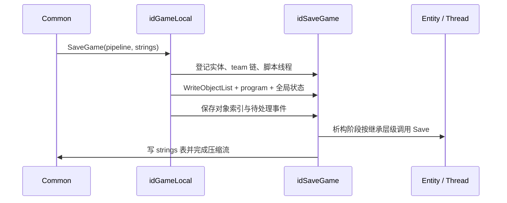

# 存档、恢复与 Render Demo

DOOM 3 BFG 有两条容易混淆的记录路径：**savegame** 序列化可恢复的单人游戏对象图；**render demo** 记录渲染世界和声音世界的命令流。后者不是完整游戏快照，也不通过恢复实体和脚本状态来播放。网络快照另用 `idSerializer`，见[网络与会话](16-network-session.md)。

## Savegame 的入口与存储边界

`Common` 明确禁止多人存档，也禁止玩家死亡后保存；从存档加载期间不能再次保存。保存前暂停游戏声音、切换输出到菜单声音世界，然后清空内存文件并建立压缩 pipeline。[neo/framework/Common_load.cpp:781-803](https://github.com/id-Software/DOOM-3-BFG/blob/1caba1979589971b5ed44e315d9ead30b278d8b4/neo/framework/Common_load.cpp#L781-L803) [neo/framework/Common_load.cpp:816-825](https://github.com/id-Software/DOOM-3-BFG/blob/1caba1979589971b5ed44e315d9ead30b278d8b4/neo/framework/Common_load.cpp#L816-L825)

存档由多个逻辑部分组成：

| 部分 | 内容 |
| --- | --- |
| 主文件头 | 游戏名、地图名、console 使用标志和 server info |
| 压缩游戏流 | 对象类型表、脚本程序、游戏状态和对象自有数据 |
| `gamedata.strings` | 主游戏流通过偏移引用的字符串表 |
| save details | 槽位、地图、版本、语言、校验等枚举和菜单元数据 |

固定文件名包括 `gamedata.save`、`gamedata.txt`、`gamedata.strings`。[neo/framework/Common_local.h:112-115](https://github.com/id-Software/DOOM-3-BFG/blob/1caba1979589971b5ed44e315d9ead30b278d8b4/neo/framework/Common_local.h#L112-L115) `Common` 先向主文件写头，再调用 `game->SaveGame(pipelineFile, &stringsFile)`，结束 pipeline 后将 strings 与主文件交给 `session->SaveGameSync`。[neo/framework/Common_load.cpp:826-858](https://github.com/id-Software/DOOM-3-BFG/blob/1caba1979589971b5ed44e315d9ead30b278d8b4/neo/framework/Common_load.cpp#L826-L858)

`idFile_SaveGamePipelined` 使用 raw deflate/inflate；按 `sgf_threads` 配置可以启动独立压缩/解压线程，native-file 模式还可以再启动写/读线程。`Finish` 会等待相关线程、冲刷最后数据并释放 zlib 状态，因此调用方不能把“所有 `Write` 已返回”当成磁盘流程已完成。[neo/framework/File_SaveGame.cpp:311-350](https://github.com/id-Software/DOOM-3-BFG/blob/1caba1979589971b5ed44e315d9ead30b278d8b4/neo/framework/File_SaveGame.cpp#L311-L350) [neo/framework/File_SaveGame.cpp:201-253](https://github.com/id-Software/DOOM-3-BFG/blob/1caba1979589971b5ed44e315d9ead30b278d8b4/neo/framework/File_SaveGame.cpp#L201-L253)

平台的保存处理器将文件列表设置为 save 模式且**不删除已有文件**，再通过 `Sys_ExecuteSavegameCommandAsync` 交给平台实现；manager 在 processor 线程结束后分阶段调用 `Process()`，并处理取消、存储设备不可用和错误清理。[neo/sys/sys_session_savegames.cpp:137-172](https://github.com/id-Software/DOOM-3-BFG/blob/1caba1979589971b5ed44e315d9ead30b278d8b4/neo/sys/sys_session_savegames.cpp#L137-L172) [neo/sys/sys_savegame.cpp:800-847](https://github.com/id-Software/DOOM-3-BFG/blob/1caba1979589971b5ed44e315d9ead30b278d8b4/neo/sys/sys_savegame.cpp#L800-L847)

## 对象图先登记，后序列化

保存时先遍历 `MAX_GENTITIES`：team 非 master 不单独作为遍历入口，而是从 master 沿 team 链逐个 `AddObject`；所有 `idThread` 也加入同一对象表。对象表索引 0 保留给 null，`AddUnique` 防止重复。[neo/d3xp/Game_local.cpp:471-493](https://github.com/id-Software/DOOM-3-BFG/blob/1caba1979589971b5ed44e315d9ead30b278d8b4/neo/d3xp/Game_local.cpp#L471-L493) [neo/d3xp/gamesys/SaveGame.cpp:69-82](https://github.com/id-Software/DOOM-3-BFG/blob/1caba1979589971b5ed44e315d9ead30b278d8b4/neo/d3xp/gamesys/SaveGame.cpp#L69-L82) [neo/d3xp/gamesys/SaveGame.cpp:188-193](https://github.com/id-Software/DOOM-3-BFG/blob/1caba1979589971b5ed44e315d9ead30b278d8b4/neo/d3xp/gamesys/SaveGame.cpp#L188-L193)

`WriteObject` 只写对象在表中的索引；未登记指针会输出调试信息并写成 null 索引，而不是自动把新对象追加到存档。对象类名列表先于对象数据写入。[neo/d3xp/gamesys/SaveGame.cpp:162-166](https://github.com/id-Software/DOOM-3-BFG/blob/1caba1979589971b5ed44e315d9ead30b278d8b4/neo/d3xp/gamesys/SaveGame.cpp#L162-L166) [neo/d3xp/gamesys/SaveGame.cpp:382-394](https://github.com/id-Software/DOOM-3-BFG/blob/1caba1979589971b5ed44e315d9ead30b278d8b4/neo/d3xp/gamesys/SaveGame.cpp#L382-L394)

`idGameLocal::SaveGame` 随后保存脚本 program、skill、已解析 decl 名称、server/persistent 信息、实体槽与 spawn id、活动/生成链表、随机种子、时间、慢动作、PVS、重力和待处理事件等。[neo/d3xp/Game_local.cpp:493-589](https://github.com/id-Software/DOOM-3-BFG/blob/1caba1979589971b5ed44e315d9ead30b278d8b4/neo/d3xp/Game_local.cpp#L493-L589) [neo/d3xp/Game_local.cpp:1390-1433](https://github.com/id-Software/DOOM-3-BFG/blob/1caba1979589971b5ed44e315d9ead30b278d8b4/neo/d3xp/Game_local.cpp#L1390-L1433) 当前代码中的 per-client `usercmd` 读写只是 `dummy` 占位，并没有把 `idUserCmdMgr` 的真实输入历史接入存档。[neo/d3xp/Game_local.cpp:503-512](https://github.com/id-Software/DOOM-3-BFG/blob/1caba1979589971b5ed44e315d9ead30b278d8b4/neo/d3xp/Game_local.cpp#L503-L512) [neo/d3xp/Game_local.cpp:1261-1269](https://github.com/id-Software/DOOM-3-BFG/blob/1caba1979589971b5ed44e315d9ead30b278d8b4/neo/d3xp/Game_local.cpp#L1261-L1269)

`idSaveGame` 析构时的 `Close` 才写 sound commands、共享 trace models 和每个对象的 `Save` 数据。`CallSave_r` 自基类向派生类调用，并跳过没有覆盖 `Save` 的重复继承层；最后写独立字符串表，并检查主缓冲和字符串表大小限制。[neo/d3xp/gamesys/SaveGame.cpp:103-125](https://github.com/id-Software/DOOM-3-BFG/blob/1caba1979589971b5ed44e315d9ead30b278d8b4/neo/d3xp/gamesys/SaveGame.cpp#L103-L125) [neo/d3xp/gamesys/SaveGame.cpp:174-184](https://github.com/id-Software/DOOM-3-BFG/blob/1caba1979589971b5ed44e315d9ead30b278d8b4/neo/d3xp/gamesys/SaveGame.cpp#L174-L184)

字符串本身不直接重复写进压缩流：主流保存字符串表偏移，空字符串为 -1；恢复时按偏移 seek 到 string 文件读取。因此主文件和 strings 文件是不可随意拆分的配对数据。[neo/d3xp/gamesys/SaveGame.cpp:272-295](https://github.com/id-Software/DOOM-3-BFG/blob/1caba1979589971b5ed44e315d9ead30b278d8b4/neo/d3xp/gamesys/SaveGame.cpp#L272-L295) [neo/d3xp/gamesys/SaveGame.cpp:1052-1065](https://github.com/id-Software/DOOM-3-BFG/blob/1caba1979589971b5ed44e315d9ead30b278d8b4/neo/d3xp/gamesys/SaveGame.cpp#L1052-L1065)

## 恢复顺序与兼容失败

加载入口先检查当前游戏、登录用户和枚举槽位；存档语言与当前 `sys_lang` 不一致时显示对话框并拒绝直接加载。随后以相同顺序加载 strings 与主文件，暂存到 `mapSpawnData`，实际恢复发生在地图装载流程。[neo/framework/Common_load.cpp:874-943](https://github.com/id-Software/DOOM-3-BFG/blob/1caba1979589971b5ed44e315d9ead30b278d8b4/neo/framework/Common_load.cpp#L874-L943)

`InitFromSaveGame` 先卸载旧地图并加载目标地图，再创建解压 pipeline 和 `idRestoreGame`。`CreateObjects` 根据类名通过 `idClass::GetClass` 实例化**全部对象**，未知类会进入恢复错误路径；这样后续读取对象索引时指针已可指向有效实例，但不要求其他对象已完成恢复。[neo/d3xp/Game_local.cpp:1213-1240](https://github.com/id-Software/DOOM-3-BFG/blob/1caba1979589971b5ed44e315d9ead30b278d8b4/neo/d3xp/Game_local.cpp#L1213-L1240) [neo/d3xp/gamesys/SaveGame.cpp:865-888](https://github.com/id-Software/DOOM-3-BFG/blob/1caba1979589971b5ed44e315d9ead30b278d8b4/neo/d3xp/gamesys/SaveGame.cpp#L865-L888)

`program.Restore` 验证脚本程序；失败时删除已创建对象、重启 program 并返回 `false`，`Common` 随后退出当前 match 回标题。源码注释保留了“利用头部 persistent info 从关卡开头恢复”的设计意图，但当前 `Common_load` 的可见失败分支是 `QuitMatchToTitle`，不能把它描述为已实现的自动关卡重开。[neo/d3xp/Game_local.cpp:1242-1250](https://github.com/id-Software/DOOM-3-BFG/blob/1caba1979589971b5ed44e315d9ead30b278d8b4/neo/d3xp/Game_local.cpp#L1242-L1250) [neo/framework/Common_load.cpp:527-532](https://github.com/id-Software/DOOM-3-BFG/blob/1caba1979589971b5ed44e315d9ead30b278d8b4/neo/framework/Common_load.cpp#L527-L532)

恢复主体按保存时的相同顺序读取状态，重建实体编号、spawned/active 链表和待处理事件，最后 `RestoreObjects`：读取 sound commands 和 trace models，自基类向派生类调用 `Restore`，再对每个实体执行 `UpdateVisuals` 与 `Present`。渲染句柄不是直接按旧值恢复，而是由实体呈现状态重新生成。[neo/d3xp/Game_local.cpp:1271-1331](https://github.com/id-Software/DOOM-3-BFG/blob/1caba1979589971b5ed44e315d9ead30b278d8b4/neo/d3xp/Game_local.cpp#L1271-L1331) [neo/d3xp/gamesys/SaveGame.cpp:896-916](https://github.com/id-Software/DOOM-3-BFG/blob/1caba1979589971b5ed44e315d9ead30b278d8b4/neo/d3xp/gamesys/SaveGame.cpp#L896-L916)

地图 area 数与存档不一致会报恢复错误；对象索引越界同样进入 `idRestoreGame::Error`，该函数删除对象内容并调用 `gameLocal.Error`。[neo/d3xp/Game_local.cpp:1390-1400](https://github.com/id-Software/DOOM-3-BFG/blob/1caba1979589971b5ed44e315d9ead30b278d8b4/neo/d3xp/Game_local.cpp#L1390-L1400) [neo/d3xp/gamesys/SaveGame.cpp:945-955](https://github.com/id-Software/DOOM-3-BFG/blob/1caba1979589971b5ed44e315d9ead30b278d8b4/neo/d3xp/gamesys/SaveGame.cpp#L945-L955) [neo/d3xp/gamesys/SaveGame.cpp:1152-1160](https://github.com/id-Software/DOOM-3-BFG/blob/1caba1979589971b5ed44e315d9ead30b278d8b4/neo/d3xp/gamesys/SaveGame.cpp#L1152-L1160)

## Render Demo 记录什么

录制入口写 `DS_VERSION` 和 `RENDERDEMO_VERSION`，然后让当前 sound world 与 render world 分别 dump 初始状态。播放前会停止当前游戏并切换到 demo 播放路径。[neo/framework/Common_demos.cpp:58-88](https://github.com/id-Software/DOOM-3-BFG/blob/1caba1979589971b5ed44e315d9ead30b278d8b4/neo/framework/Common_demos.cpp#L58-L88) [neo/framework/Common_demos.cpp:172-205](https://github.com/id-Software/DOOM-3-BFG/blob/1caba1979589971b5ed44e315d9ead30b278d8b4/neo/framework/Common_demos.cpp#L172-L205)

`idDemoFile` 写文件 magic 和压缩类型；读取时若 magic 不存在，为兼容旧格式回退为未压缩并 rewind，而不是直接拒绝。可选 `com_preloadDemos` 将整个文件读入内存；关闭写文件时必须 `FinishCompress`。[neo/framework/DemoFile.cpp:81-122](https://github.com/id-Software/DOOM-3-BFG/blob/1caba1979589971b5ed44e315d9ead30b278d8b4/neo/framework/DemoFile.cpp#L81-L122) [neo/framework/DemoFile.cpp:153-185](https://github.com/id-Software/DOOM-3-BFG/blob/1caba1979589971b5ed44e315d9ead30b278d8b4/neo/framework/DemoFile.cpp#L153-L185)

播放循环读取 `DS_RENDER` 或 `DS_SOUND`，分别交给 `renderWorld->ProcessDemoCommand` 或 `soundWorld->ProcessDemoCommand`；`DS_FINISHED` 停止，其他 token 报错。渲染命令包括地图加载、render view 和 entity/light def 更新等，例如 view 记录 FOV、原点、轴、时间和 shader parms。[neo/framework/Common_demos.cpp:392-416](https://github.com/id-Software/DOOM-3-BFG/blob/1caba1979589971b5ed44e315d9ead30b278d8b4/neo/framework/Common_demos.cpp#L392-L416) [neo/renderer/RenderWorld_demo.cpp:335-350](https://github.com/id-Software/DOOM-3-BFG/blob/1caba1979589971b5ed44e315d9ead30b278d8b4/neo/renderer/RenderWorld_demo.cpp#L335-L350)

因此 render demo 适用于视觉/声音重放和 timedemo，不应被当作恢复 AI、脚本 VM、物理或网络游戏的通用机制。

## `idSerializer` 不是 savegame 替代品

`idSerializer` 包装 `idBitMsg` 和读写方向，让同一段代码按方向选择 `Write*` 或 `Read*`；它提供 range、delta、量化角度等网络友好的编码。[neo/framework/Serializer.h:84-103](https://github.com/id-Software/DOOM-3-BFG/blob/1caba1979589971b5ed44e315d9ead30b278d8b4/neo/framework/Serializer.h#L84-L103) [neo/framework/Serializer.h:197-208](https://github.com/id-Software/DOOM-3-BFG/blob/1caba1979589971b5ed44e315d9ead30b278d8b4/neo/framework/Serializer.h#L197-L208) 它解决紧凑消息编码，不负责 savegame 的对象类型实例化、字符串侧表、压缩 pipeline 或平台槽位管理。

## 修改约束

- 新对象引用必须在保存前进入对象表；只在 `Save` 中 `WriteObject` 而未登记会退化为 null。
- 修改任一 `Save`/`Restore` 字段顺序要同步两端，并用 `BUILD_NUMBER`/版本分支处理旧档；脚本变化还要考虑 `program.Restore` 失败。
- `Restore` 不应依赖其他对象已完全恢复；跨对象修正应延迟到整个对象图恢复后。
- 新瞬时特效要显式决定保存还是重建；源码仍留有 `FIXME: save smoke particles`，不能假设所有视觉状态都在档内。[neo/d3xp/Game_local.cpp:557-560](https://github.com/id-Software/DOOM-3-BFG/blob/1caba1979589971b5ed44e315d9ead30b278d8b4/neo/d3xp/Game_local.cpp#L557-L560)
- 修改 demo 命令格式要同步 render/sound 两端及版本；不要把游戏状态字段混入后仍期待旧播放路径能理解。

返回[总入口](index.md)。
