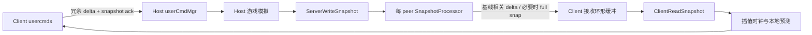

# 网络、快照与会话

多人路径横跨三层：`Common` 驱动输入与快照时序，`idGameLocal` 序列化游戏对象，`idSessionLocal`/`idLobby` 管理用户、连接和逐 peer 传输。外层帧与游戏 tic 的关系见[启动与帧循环](03-startup-frame.md)，本页聚焦多人附加的数据流。

## 身份、状态与 lobby 边界

`IsMultiplayer` 不是简单判断实体数量：party lobby 的 match flags 必须包含 `MATCH_ONLINE`，且 session 状态必须晚于 `IDLE`。在此基础上，acting game-state lobby 的 `IsHost`/`IsPeer` 决定 server/client 角色。[neo/framework/Common_network.cpp:83-104](https://github.com/id-Software/DOOM-3-BFG/blob/1caba1979589971b5ed44e315d9ead30b278d8b4/neo/framework/Common_network.cpp#L83-L104)

公开 session 状态包括 `PRESS_START`、`IDLE`、`SEARCHING`、`CONNECTING`、party/game lobby、`LOADING`、`INGAME` 和 `BUSY`；内部状态额外区分 host/peer 及创建、连接过程，再由 `GetState` 折叠成公开状态。[neo/sys/sys_session.h:355-369](https://github.com/id-Software/DOOM-3-BFG/blob/1caba1979589971b5ed44e315d9ead30b278d8b4/neo/sys/sys_session.h#L355-L369) [neo/sys/sys_session_local.cpp:1913-1966](https://github.com/id-Software/DOOM-3-BFG/blob/1caba1979589971b5ed44e315d9ead30b278d8b4/neo/sys/sys_session_local.cpp#L1913-L1966)

`SetState` 跨过 loading 边界时调用 `StartSessions` 或 `EndSessions`；从游戏返回 lobby 时，migration game 有例外，不立即结束 session。[neo/sys/sys_session_local.cpp:2263-2294](https://github.com/id-Software/DOOM-3-BFG/blob/1caba1979589971b5ed44e315d9ead30b278d8b4/neo/sys/sys_session_local.cpp#L2263-L2294) `net_useGameStateLobby` 决定 acting lobby 使用独立 game-state lobby 还是普通 game lobby，所以调用方应通过 `GetActingGameStateLobbyBase` 取当前实例，而不是硬编码某一个。[neo/sys/sys_session_local.cpp:2388-2394](https://github.com/id-Software/DOOM-3-BFG/blob/1caba1979589971b5ed44e315d9ead30b278d8b4/neo/sys/sys_session_local.cpp#L2388-L2394)

host 的 `SyncPlayersWithLobbyUsers` 将已加载的新 lobby user 分配到空闲 player slot，重置输入、生成玩家并发送初始 reliable messages；失效 lobby user 对应玩家会被删除。已验证玩家随后启用快照。[neo/d3xp/Game_network.cpp:117-176](https://github.com/id-Software/DOOM-3-BFG/blob/1caba1979589971b5ed44e315d9ead30b278d8b4/neo/d3xp/Game_network.cpp#L117-L176) [neo/d3xp/Game_network.cpp:179-213](https://github.com/id-Software/DOOM-3-BFG/blob/1caba1979589971b5ed44e315d9ead30b278d8b4/neo/d3xp/Game_network.cpp#L179-L213)

## Win32 direct backend 的真实边界

Win32 `CreateLobbyInternal` 总是创建 `idLobbyBackendDirect`，party、game、game-state 三类只是 backend 类型标记。socket port 先尝试 `net_port`，失败时改用任意可用端口，并允许本机回环 join。[neo/sys/win32/win_session_local.cpp:557-579](https://github.com/id-Software/DOOM-3-BFG/blob/1caba1979589971b5ed44e315d9ead30b278d8b4/neo/sys/win32/win_session_local.cpp#L557-L579) [neo/sys/win32/win_session_local.cpp:653-662](https://github.com/id-Software/DOOM-3-BFG/blob/1caba1979589971b5ed44e315d9ead30b278d8b4/neo/sys/win32/win_session_local.cpp#L653-L662)

direct backend 的 host 地址来自本地 IP 与 `net_port`；join 可直接使用 connect info 中的地址。其 `GetSearchResults` 只返回一个默认的 fake result，`Pump`、match 参数更新等函数为空，因此这里不是完整的在线发现/平台 matchmaking 服务。真正的 UDP 包仍由 session/lobby 层处理。[neo/sys/sys_lobby_backend_direct.cpp:66-104](https://github.com/id-Software/DOOM-3-BFG/blob/1caba1979589971b5ed44e315d9ead30b278d8b4/neo/sys/sys_lobby_backend_direct.cpp#L66-L104) [neo/sys/sys_lobby_backend_direct.cpp:155-186](https://github.com/id-Software/DOOM-3-BFG/blob/1caba1979589971b5ed44e315d9ead30b278d8b4/neo/sys/sys_lobby_backend_direct.cpp#L155-L186)

不要把 fake `GetSearchResults` 与 connectionless LAN 查询混为一谈。`ListServersCommon` 另行向 `NA_BROADCAST` 发送 `OOB_MATCH_QUERY`；接收 host 校验版本 checksum、session、空位和邀请限制后，以 `OOB_MATCH_QUERY_ACK` 返回 server info 与玩家名，查询方再更新 dedicated-server list 并触发回调。这条路径有真实 UDP 查询/响应代码，但本 Wiki 未实测服务器浏览 UI 或跨主机发现。[neo/sys/sys_session_local.cpp:3962-3983](https://github.com/id-Software/DOOM-3-BFG/blob/1caba1979589971b5ed44e315d9ead30b278d8b4/neo/sys/sys_session_local.cpp#L3962-L3983) [neo/sys/sys_session_local.cpp:3991-4063](https://github.com/id-Software/DOOM-3-BFG/blob/1caba1979589971b5ed44e315d9ead30b278d8b4/neo/sys/sys_session_local.cpp#L3991-L4063) [neo/sys/sys_dedicated_server_search.cpp:84-136](https://github.com/id-Software/DOOM-3-BFG/blob/1caba1979589971b5ed44e315d9ead30b278d8b4/neo/sys/sys_dedicated_server_search.cpp#L84-L136)

`HandlePackets` 从 raw packet 读取 session id，拒绝 invalid id，再按其中 lobby type 分发给 party、game 或 game-state lobby。[neo/sys/sys_session_local.cpp:2301-2344](https://github.com/id-Software/DOOM-3-BFG/blob/1caba1979589971b5ed44e315d9ead30b278d8b4/neo/sys/sys_session_local.cpp#L2301-L2344)

## Usercmd：冗余、去重与服务端消耗

默认 `net_ucmdRate` 为 40 ms，`net_snapRate` 为 100 ms，都是可配置 cvar，不是协议常量。[neo/framework/Common_network.cpp:33-35](https://github.com/id-Software/DOOM-3-BFG/blob/1caba1979589971b5ed44e315d9ead30b278d8b4/neo/framework/Common_network.cpp#L33-L35) peer 每次发送最近 `NUM_USERCMD_SEND` 个命令，以相邻命令为 base 做 delta serialization；重复发送用于抵抗丢包，接收端只保留 `clientGameMilliseconds` 大于当前最新值的命令再放入 `idUserCmdMgr`。[neo/framework/Common_network.cpp:170-201](https://github.com/id-Software/DOOM-3-BFG/blob/1caba1979589971b5ed44e315d9ead30b278d8b4/neo/framework/Common_network.cpp#L170-L201) [neo/framework/Common_network.cpp:328-364](https://github.com/id-Software/DOOM-3-BFG/blob/1caba1979589971b5ed44e315d9ead30b278d8b4/neo/framework/Common_network.cpp#L328-L364)

`usercmd_t::Serialize` 覆盖 buttons、移动、视角、位置、客户端/服务端时间、fire count、速度和 impulse 序列等字段；修改输入结构时必须同时考虑 delta base 和旧包兼容。[neo/framework/UsercmdGen.cpp:70-86](https://github.com/id-Software/DOOM-3-BFG/blob/1caba1979589971b5ed44e315d9ead30b278d8b4/neo/framework/UsercmdGen.cpp#L70-L86)

session 发送 usercmd 时还附带最近接收的 snapshot sequence 和量化 incoming BPS，并用 LZW 压缩后写入 host 的 in-band channel。若 host peer 还有未发送 fragments，本次 usercmd 发送会跳过。[neo/sys/sys_session_local.cpp:2028-2067](https://github.com/id-Software/DOOM-3-BFG/blob/1caba1979589971b5ed44e315d9ead30b278d8b4/neo/sys/sys_session_local.cpp#L2028-L2067) host 收包后应用这个 snapshot ack，再把 usercmd 部分交给 `NetReceiveUsercmds`。[neo/sys/sys_lobby_snapshot.cpp:570-599](https://github.com/id-Software/DOOM-3-BFG/blob/1caba1979589971b5ed44e315d9ead30b278d8b4/neo/sys/sys_lobby_snapshot.cpp#L570-L599)

本地玩家每个游戏帧最多消费一个新 usercmd，没有新命令时重复当前命令，避免低帧率下脚步声等效果挤在同一帧。server 对远端玩家则根据 client/server 时间差追赶、复制或清空移动输入：client 更快时可连续执行多个命令，server 更快时复制上一命令，buffer 耗尽时保留其他字段但清零 forward/right move。[neo/d3xp/Game_local.cpp:2542-2568](https://github.com/id-Software/DOOM-3-BFG/blob/1caba1979589971b5ed44e315d9ead30b278d8b4/neo/d3xp/Game_local.cpp#L2542-L2568) [neo/d3xp/Game_local.cpp:2571-2625](https://github.com/id-Software/DOOM-3-BFG/blob/1caba1979589971b5ed44e315d9ead30b278d8b4/neo/d3xp/Game_local.cpp#L2571-L2625)

## Host 快照的组成

只有地图已生成、当前 lobby 为 host 且有 active peers 时，`Common::SendSnapshots` 才构造并发送 `idSnapShot`。[neo/framework/Common_network.cpp:120-139](https://github.com/id-Software/DOOM-3-BFG/blob/1caba1979589971b5ed44e315d9ead30b278d8b4/neo/framework/Common_network.cpp#L120-L139) `ServerWriteSnapshot` 写入：

- match 状态、全局 shader parms 和 portal 状态；
- 每个玩家的 player state 与 server 最后处理的 usercmd 时间；
- 每个未设置 `GetSkipReplication` 的实体：spawn id、runtime type、entityDef、prediction key，以及 `networkSync` 时的类专有数据。[neo/d3xp/Game_network.cpp:315-405](https://github.com/id-Software/DOOM-3-BFG/blob/1caba1979589971b5ed44e315d9ead30b278d8b4/neo/d3xp/Game_network.cpp#L315-L405)

代码会计算玩家和 portal-sky PVS handle，但当前每个实体 `S_AddObject` 的 `visMask` 都是 `~0U`，随后只释放 PVS handle。因此不能仅凭这段 PVS 计算就断言当前复制已按玩家 PVS 过滤实体；需要继续沿 `visMask`/delta 路径验证或修改。[neo/d3xp/Game_network.cpp:343-405](https://github.com/id-Software/DOOM-3-BFG/blob/1caba1979589971b5ed44e315d9ead30b278d8b4/neo/d3xp/Game_network.cpp#L343-L405) [neo/d3xp/Game_network.cpp:408-414](https://github.com/id-Software/DOOM-3-BFG/blob/1caba1979589971b5ed44e315d9ead30b278d8b4/neo/d3xp/Game_network.cpp#L408-L414)

session 只向 connected、loaded 且未暂停快照的 peer 发送。[neo/sys/sys_session_local.cpp:2076-2093](https://github.com/id-Software/DOOM-3-BFG/blob/1caba1979589971b5ed44e315d9ead30b278d8b4/neo/sys/sys_session_local.cpp#L2076-L2093) 每个 peer 的 `SnapshotProcessor` 在上一份 pending snap 未完成时拒绝替换；发送路径还会按 peer 节流和带宽状态跳过，并标记后续统一提交 delta jobs。[neo/sys/SnapshotProcessor.cpp:95-103](https://github.com/id-Software/DOOM-3-BFG/blob/1caba1979589971b5ed44e315d9ead30b278d8b4/neo/sys/SnapshotProcessor.cpp#L95-L103) [neo/sys/sys_lobby_snapshot.cpp:492-550](https://github.com/id-Software/DOOM-3-BFG/blob/1caba1979589971b5ed44e315d9ead30b278d8b4/neo/sys/sys_lobby_snapshot.cpp#L492-L550)

发送 delta 带 snapshot sequence 和 base sequence；处理器检查序号和输出大小，并保存仍需重发的 delta。job 计算期间若 peer 已 ack 更新的 base state，则不再保存无意义的旧 delta。[neo/sys/SnapshotProcessor.cpp:225-261](https://github.com/id-Software/DOOM-3-BFG/blob/1caba1979589971b5ed44e315d9ead30b278d8b4/neo/sys/SnapshotProcessor.cpp#L225-L261) 客户端 usercmd 中的 ack 与快照 delta 因此构成逐 peer 基线推进机制，而不是所有 peer 共用一份已确认状态。

## Client 接收、插值与预测

接收快照先记录本地 recv time 并放入环形缓冲。缓冲将覆盖最老项时强制先处理它；最初两份快照立即处理以建立 previous/current 时间锚点。[neo/framework/Common_network.cpp:147-163](https://github.com/id-Software/DOOM-3-BFG/blob/1caba1979589971b5ed44e315d9ead30b278d8b4/neo/framework/Common_network.cpp#L147-L163)

网络帧先执行 reliable queue，再在 previous/current server time 之间推进插值时钟。当前时间越过 current snap 时取下一份；`net_maxExtrapolationInMS` 默认 0，意味着默认不允许越过快照末端做时间外推。[neo/framework/Common_network.cpp:73-75](https://github.com/id-Software/DOOM-3-BFG/blob/1caba1979589971b5ed44e315d9ead30b278d8b4/neo/framework/Common_network.cpp#L73-L75) [neo/framework/Common_network.cpp:441-496](https://github.com/id-Software/DOOM-3-BFG/blob/1caba1979589971b5ed44e315d9ead30b278d8b4/neo/framework/Common_network.cpp#L441-L496)

插值不仅使用固定 fraction：代码根据实际 snap 间隔、当前 buffered time 和目标缓冲窗口缩放推进速度，缓冲不足时减速甚至暂停，缓冲过多时按 catch-up rate 加速。[neo/framework/Common_network.cpp:498-567](https://github.com/id-Software/DOOM-3-BFG/blob/1caba1979589971b5ed44e315d9ead30b278d8b4/neo/framework/Common_network.cpp#L498-L567) `InterpolateSnapshot` 把插值得到的 server time 和 fraction 写回 game；真正的本地预测在 `ClientRunFrame` 中对活动实体执行，非本地玩家走 `ClientThink`，本地玩家消费 usercmd。[neo/framework/Common_network.cpp:425-434](https://github.com/id-Software/DOOM-3-BFG/blob/1caba1979589971b5ed44e315d9ead30b278d8b4/neo/framework/Common_network.cpp#L425-L434) [neo/d3xp/Game_network.cpp:1031-1087](https://github.com/id-Software/DOOM-3-BFG/blob/1caba1979589971b5ed44e315d9ead30b278d8b4/neo/d3xp/Game_network.cpp#L1031-L1087)

`ClientReadSnapshot` 按 object id 分流全局状态和实体。实体消息为空表示删除；spawn id、type 或 entityDef 不匹配时删除并重建，玩家 slot 使用专门 `SpawnPlayer` 路径。[neo/d3xp/Game_network.cpp:651-733](https://github.com/id-Software/DOOM-3-BFG/blob/1caba1979589971b5ed44e315d9ead30b278d8b4/neo/d3xp/Game_network.cpp#L651-L733) [neo/d3xp/Game_network.cpp:785-824](https://github.com/id-Software/DOOM-3-BFG/blob/1caba1979589971b5ed44e315d9ead30b278d8b4/neo/d3xp/Game_network.cpp#L785-L824)

stale 实体通常释放模型和灯、更新视觉并 unlink clip；重新变为非 stale 时加入 snapshot list，按 changed count 设置消息变化标志并读取类数据。[neo/d3xp/Game_network.cpp:831-864](https://github.com/id-Software/DOOM-3-BFG/blob/1caba1979589971b5ed44e315d9ead30b278d8b4/neo/d3xp/Game_network.cpp#L831-L864)

prediction key 用于识别客户端预生成实体，但当前匹配分支只验证实体位于非复制区并 `continue`，真正移动实体、调用 `BecomeReplicated` 的代码位于 `#if 0` 内。维护者不应把注释中的“move predicted entity”描述成当前已启用行为。[neo/d3xp/Game_network.cpp:736-783](https://github.com/id-Software/DOOM-3-BFG/blob/1caba1979589971b5ed44e315d9ead30b278d8b4/neo/d3xp/Game_network.cpp#L736-L783)

## Reliable 消息

`idLobby::SendReliable` 要求 type 小于 256 且消息尚未读取；默认先在本地调用 `NetReceiveReliable`，再按去重后的 peer 集合排队。定向发送给 lobby user 或 host 有各自本地/远端分支。[neo/sys/sys_lobby.cpp:3906-3953](https://github.com/id-Software/DOOM-3-BFG/blob/1caba1979589971b5ed44e315d9ead30b278d8b4/neo/sys/sys_lobby.cpp#L3906-L3953) [neo/sys/sys_lobby.cpp:3962-3991](https://github.com/id-Software/DOOM-3-BFG/blob/1caba1979589971b5ed44e315d9ead30b278d8b4/neo/sys/sys_lobby.cpp#L3962-L3991) 这与 usercmd/snapshot 的非可靠、序列化增量通道不同，修改消息类型时必须同时检查本地回环和远端接收处理。

## 修改约束

- 新 usercmd 字段要同步 delta serialization、输入缓冲、重复/空命令策略和快照确认时间。
- 新复制对象要使用稳定 object id，明确 empty/stale/deleted 的语义，并同步 server remap 与 client remap。
- 不要把 `networkSync`、snapshot stale、PVS handle 和 `visMask` 混为同一开关；当前代码中它们承担不同职责。
- 调整 `net_snapRate`、job 并发或 ack 格式时，验证逐 peer base sequence、重发与 full-snapshot 恢复。
- direct backend 不包含商业平台服务；本 Wiki 未对 Steam 或未发布在线后端作实现假设，也未进行多人联机实测。

返回[游戏运行时](10-game-runtime.md)或[总入口](index.md)。
