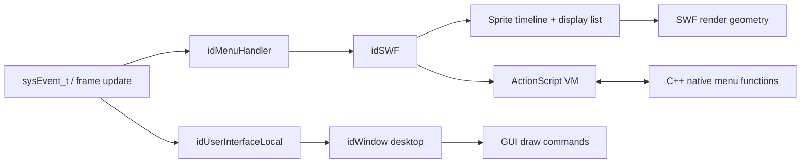

# 原生 GUI、菜单与 SWF 运行时

本页区分两套仍然共存的界面路径：`neo/ui` 解析 DOOM 3 风格的 `windowDef`，`neo/swf` 与 `neo/d3xp/menus` 则运行 BFG 菜单使用的 SWF/ActionScript 子集。二者都会进入[启动帧循环](03-startup-frame.md)中的事件和绘制流程，但不能把 SWF 路径当成原生 GUI 的简单文件格式替换。

## 关键源码

- `neo/ui/UserInterface.cpp`、`neo/ui/Window.cpp`：原生 GUI 的复用、解析、事件和绘制。
- `neo/d3xp/menus/MenuHandler.cpp`、`MenuScreen.cpp`、`MenuWidget.cpp`：C++ 菜单状态与 SWF 对象的桥接。
- `neo/swf/SWF_Main.cpp`、`SWF_Load.cpp`、`SWF_Sprites.cpp`：SWF 加载、缓存和时间线。
- `neo/swf/SWF_ScriptFunction.cpp`、`SWF_Render.cpp`、`SWF_Events.cpp`：脚本执行、帧推进和输入分发。

## 两条界面路径

原生分支的窗口事件与绘制见 [UserInterface.cpp:394-435](../../_src/DOOM-3-BFG/neo/ui/UserInterface.cpp#L394-L435)；菜单到 `idSWF::Render` 的调用见 [MenuHandler.cpp:268-274](../../_src/DOOM-3-BFG/neo/d3xp/menus/MenuHandler.cpp#L268-L274)，native function 注册见 [MenuHandler.cpp:222-260](../../_src/DOOM-3-BFG/neo/d3xp/menus/MenuHandler.cpp#L222-L260)。

## 原生 GUI 的实例与解析契约

`FindGui` 先按规范化前的 `qpath` 字符串查找现有实例。可共享的非交互 GUI 会增加引用并复用；请求 unique 或现有 GUI 为 interactive 时会跳出复用循环，并在 `autoLoad` 下另建实例。`forceNOTUnique` 同时影响复用判断和新实例的 `uniqued` 标记，因此修改调用方时不能只考虑 `needUnique`。[neo/ui/UserInterface.cpp:223-254](../../_src/DOOM-3-BFG/neo/ui/UserInterface.cpp#L223-L254)

`InitFromFile` 先把 `guis/` 替换为 `guis/<sys_lang>/` 尝试本地化资源，再回退到原路径。解析优先复用二进制 token parser，必要时从文本 `idParser` 建立 token 缓存；顶层 `windowDef` 被交给 desktop `idWindow::Parse`，随后修正参数并重新计算 `interactive`。[neo/ui/UserInterface.cpp:316-374](../../_src/DOOM-3-BFG/neo/ui/UserInterface.cpp#L316-L374) [neo/ui/UserInterface.cpp:386-390](../../_src/DOOM-3-BFG/neo/ui/UserInterface.cpp#L386-L390)

加载失败有一个容易误判的边界：parser 无法加载时，代码构造显示 `Invalid GUI` 的 desktop、发出 warning，但函数最终仍返回 `true`。因此 `FindGui` 的非空结果只表示界面对象已建立，不证明资源脚本有效。[neo/ui/UserInterface.cpp:375-391](../../_src/DOOM-3-BFG/neo/ui/UserInterface.cpp#L375-L391)

运行期，`HandleEvent` 更新鼠标坐标后委托 desktop；`Redraw` 在 screen clip rect 内递归绘制窗口；`Activate` 与 `Trigger` 则驱动窗口状态。GUI 状态不是每帧从文件重建，修改其状态字典或命名事件时需要保留已有对象生命周期。[neo/ui/UserInterface.cpp:394-435](../../_src/DOOM-3-BFG/neo/ui/UserInterface.cpp#L394-L435) [neo/ui/UserInterface.cpp:504-519](../../_src/DOOM-3-BFG/neo/ui/UserInterface.cpp#L504-L519)

## SWF 加载与二进制缓存

SWF 路径被规范化为 `swf/*.swf`。运行时会先尝试 `generated/*.bswf`；缓存不可用才加载源 SWF、生成图像 atlas 并写回缓存。因而调试菜单资源时，源文件、生成缓存和图像 atlas 是三个需要一起核对的层次。[neo/swf/SWF_Main.cpp:104-136](../../_src/DOOM-3-BFG/neo/swf/SWF_Main.cpp#L104-L136)

源加载器接受未压缩 `FWS` 和 zlib 压缩 `CWS`，拒绝版本大于 9 的文件；加载后生成 atlas。BSWF 缓存则检查 magic、版本，并在非 production 构建中比较源文件时间戳，避免无提示地使用过期缓存。[neo/swf/SWF_Load.cpp:42-122](../../_src/DOOM-3-BFG/neo/swf/SWF_Load.cpp#L42-L122) [neo/swf/SWF_Load.cpp:130-144](../../_src/DOOM-3-BFG/neo/swf/SWF_Load.cpp#L130-L144)

对象建立后，运行时创建 globals、注册 native functions、建立 `_root` 与主 sprite，再执行初始 `Run`、`RunActions` 和 `RunTo(0)`。重新激活不是单纯设置布尔值：它清空 display list，随后 Play、Run 并执行动作，让时间线对象重新进入活动状态。[neo/swf/SWF_Main.cpp:138-194](../../_src/DOOM-3-BFG/neo/swf/SWF_Main.cpp#L138-L194) [neo/swf/SWF_Main.cpp:253-264](../../_src/DOOM-3-BFG/neo/swf/SWF_Main.cpp#L253-L264)

## 时间线、脚本与菜单桥接

sprite 加载器把 definition tags 写入 dictionary，把 `DoAction`、`PlaceObject2/3` 和 `RemoveObject2` 留作运行期 command；`ShowFrame` 记录帧偏移，`FrameLabel` 保存名称到帧号的映射。未支持的 tags 会被忽略，`DefineMorphShape` 明确没有启用，所以本实现是面向游戏资源的 SWF 子集，而不是完整 Flash 兼容层。[neo/swf/SWF_Sprites.cpp:96-167](../../_src/DOOM-3-BFG/neo/swf/SWF_Sprites.cpp#L96-L167)

执行 sprite 时，ActionScript 数据交给 `idSWFScriptFunction_Script`，并递归处理子 sprite；脚本函数内部维护 program counter、stack 和局部变量，说明这里确有字节码 VM，而不只是 C++ 回调绑定。[neo/swf/SWF_SpriteInstance.cpp:264-296](../../_src/DOOM-3-BFG/neo/swf/SWF_SpriteInstance.cpp#L264-L296) [neo/swf/SWF_ScriptFunction.cpp:394-475](../../_src/DOOM-3-BFG/neo/swf/SWF_ScriptFunction.cpp#L394-L475)

跳帧的语义也有边界：`RunTo` 遍历跨越区间的 commands，跳过早于目标帧的 `DoAction`，但仍处理 display-list 与 `StartSound`；保留下来的 `DoAction` 只是加入动作队列，之后由 `RunActions` 执行，并非在 `RunTo` 内立即运行。菜单逻辑若依赖逐帧脚本副作用，跳转与顺序播放可能产生不同结果。[neo/swf/SWF_SpriteInstance.cpp:350-405](../../_src/DOOM-3-BFG/neo/swf/SWF_SpriteInstance.cpp#L350-L405) [neo/swf/SWF_Render.cpp:109-112](../../_src/DOOM-3-BFG/neo/swf/SWF_Render.cpp#L109-L112)

C++ 菜单层在激活时注册 `updateMenuDisplay` 和 `activateMenus` 两个全局 native functions，使脚本可以请求刷新 screen 或触发菜单；`idMenuHandler::Update` 每帧处理 widget action repeater，再渲染活动 SWF。widget 的 sprite path 可延迟解析，screen 则通过 sprite frame 切换表现 roll-on/roll-off 等状态。[neo/d3xp/menus/MenuHandler.cpp:222-274](../../_src/DOOM-3-BFG/neo/d3xp/menus/MenuHandler.cpp#L222-L274) [neo/d3xp/menus/MenuWidget.cpp:331-339](../../_src/DOOM-3-BFG/neo/d3xp/menus/MenuWidget.cpp#L331-L339) [neo/d3xp/menus/MenuScreen.cpp:253-310](../../_src/DOOM-3-BFG/neo/d3xp/menus/MenuScreen.cpp#L253-L310)

## 时间推进、输入与修改约束

`idSWF::Render` 按资源 frameRate 和 `swf_timescale` 计算本次应推进帧数，一次调用最多补 10 帧，再渲染主 sprite。`lastRenderTime` 在截断前已按原计算值前进，因此超过 10 帧的积压会被丢弃，而不是留到下次继续补；也不能把每次 `Render` 都理解成恰好推进一个 SWF 帧。[neo/swf/SWF_Render.cpp:76-131](../../_src/DOOM-3-BFG/neo/swf/SWF_Render.cpp#L76-L131)

鼠标按下通过 hit test 找到脚本对象并调用 `onPress`/`onDrag`，释放时调用保存对象的 `onRelease`；键盘还可经 `shortcutKeys` 映射到函数或伪造 sprite 鼠标事件。别名解析最多 32 层，用来阻止循环映射。[neo/swf/SWF_Events.cpp:213-320](../../_src/DOOM-3-BFG/neo/swf/SWF_Events.cpp#L213-L320)

- 修改 `.gui` 时同时检查本地化路径、token cache 和“返回成功但显示 Invalid GUI”的降级行为。
- 修改 SWF 资源时核对 BSWF 失效规则与 atlas，不要只替换源文件就假定运行时已刷新。
- 新增 ActionScript 能力前检查 loader 支持的 tags 与 VM 指令，不能把桌面 Flash 的兼容性当作本引擎契约。
- 修改菜单回调时同时追踪 C++ widget 状态、脚本 native function 和 sprite 时间线，避免只改其中一层。

返回[总入口](index.md)；相关状态持久化见[存档与 Render Demo](15-persistence.md)。
