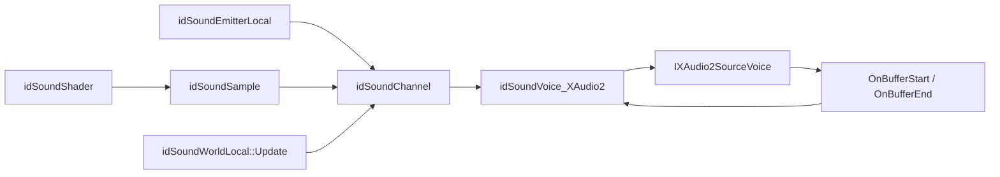

# 音频：Sound Shader、Emitter 与 XAudio2

本页沿“声明 → 样本 → 逻辑发声器 → 硬件 voice”解释声音如何从[声明系统](05-files-declarations.md)进入实时输出。重点不是 XAudio2 API 教程，而是引擎怎样选择声音、处理空间关系、在 voice 不足时降级，以及为什么逻辑播放状态与硬件播放状态不能混为一谈。

## 关键源码

- `neo/sound/snd_shader.cpp`：`idSoundShader` 声明解析与样本列表。
- `neo/sound/snd_system.cpp`：全局样本、sound world、stream buffer 和硬件管理。
- `neo/sound/snd_world.cpp`、`snd_emitter.cpp`：listener、emitter、逻辑 channel 和 voice 选择。
- `neo/sound/XAudio2/`：`.idwav` 样本、XAudio2 voice、回调和异步回收。

## 分层与每帧驱动

声明解析把 `.wav`/`.ogg` token 转为样本引用见 [snd_shader.cpp:312-325](../../_src/DOOM-3-BFG/neo/sound/snd_shader.cpp#L312-L325)；`StartSound` 把样本装入逻辑 channel 见 [snd_emitter.cpp:719-783](../../_src/DOOM-3-BFG/neo/sound/snd_emitter.cpp#L719-L783)；world 选择活动 channel 并调用 `UpdateHardware` 见 [snd_world.cpp:296-379](../../_src/DOOM-3-BFG/neo/sound/snd_world.cpp#L296-L379) [snd_world.cpp:409-434](../../_src/DOOM-3-BFG/neo/sound/snd_world.cpp#L409-L434)。

系统可以持有多个 `idSoundWorldLocal`，每个 world 关联一个可选 `renderWorld` 并分配自己的 emitters。`SetPlayingSoundWorld` 切换 current world 时还会更新一次旧 world，使其按非活动状态重算；日常 `idSoundSystemLocal::Render` 只更新 current world，然后更新硬件并把 `soundTime` 设为 `Sys_Milliseconds()`。因此这里的音频渲染时钟不是游戏 tic 计数。[neo/sound/snd_system.cpp:244-280](../../_src/DOOM-3-BFG/neo/sound/snd_system.cpp#L244-L280) [neo/sound/snd_system.cpp:296-317](../../_src/DOOM-3-BFG/neo/sound/snd_system.cpp#L296-L317)

## Shader 与样本加载

`idSoundShader::ParseShader` 把 `looping`、`global`、`no_occlusion`、`omnidirectional` 等声明转为参数或 flag，同时校验 `soundClass` 范围。若路径位于 `sound/vo/` 或 `sound/guis/` 会加 `SSF_VO`，位于 `sound/musical/` 会加 `SSF_MUSIC`；所以目录约定也参与行为分类。[neo/sound/snd_shader.cpp:246-307](../../_src/DOOM-3-BFG/neo/sound/snd_shader.cpp#L246-L307) [neo/sound/snd_shader.cpp:312-325](../../_src/DOOM-3-BFG/neo/sound/snd_shader.cpp#L312-L325)

解析器保留了若干兼容入口：`reverb` 仍消费参数但不应用，`ordered`、`plain` 和 `onDemand` 被标记为不再支持。遇到真正未知 token 则 warning 并返回失败。迁移旧 sound shader 时，“能解析”不代表所有旧关键字仍有运行时效果。[neo/sound/snd_shader.cpp:203-212](../../_src/DOOM-3-BFG/neo/sound/snd_shader.cpp#L203-L212) [neo/sound/snd_shader.cpp:261-276](../../_src/DOOM-3-BFG/neo/sound/snd_shader.cpp#L261-L276) [neo/sound/snd_shader.cpp:309-329](../../_src/DOOM-3-BFG/neo/sound/snd_shader.cpp#L309-L329)

`LoadSample` 将名称小写化、统一斜杠并去扩展名，再按 hash 复用样本。非 level-load 阶段首次引用的样本会立即加载并标记 `neverPurge`；level-load 中则只登记引用，由 preload/end-load 流程安排加载。[neo/sound/snd_system.cpp:386-413](../../_src/DOOM-3-BFG/neo/sound/snd_system.cpp#L386-L413) [neo/sound/snd_system.cpp:464-523](../../_src/DOOM-3-BFG/neo/sound/snd_system.cpp#L464-L523)

实际加载优先尝试 `generated/<name>.idwav`，失败后读取 `.msadpcm` 或 `.wav`，启用压缩但压缩源失败时还会回退 `.wav`。VO 会先尝试 `/vo/<sys_lang>/` 路径，再回退原路径；生成缓存包含格式、amplitude 和音频 buffers，而非只是一个文件索引。[neo/sound/XAudio2/XA2_SoundSample.cpp:142-169](../../_src/DOOM-3-BFG/neo/sound/XAudio2/XA2_SoundSample.cpp#L142-L169) [neo/sound/XAudio2/XA2_SoundSample.cpp:176-217](../../_src/DOOM-3-BFG/neo/sound/XAudio2/XA2_SoundSample.cpp#L176-L217) [neo/sound/XAudio2/XA2_SoundSample.cpp:94-109](../../_src/DOOM-3-BFG/neo/sound/XAudio2/XA2_SoundSample.cpp#L94-L109)

## StartSound 只先建立逻辑播放

`idSoundEmitterLocal::StartSound` 处理 play-once 和同帧重复抑制；指定逻辑 channel 时会停止并移除该 channel 的旧声音。普通多样本 shader 根据调用方提供的 `diversity` 选择 entry，`SSF_NO_DUPS` 会避开最近播放项；leadin/looping 则分别保存样本。[neo/sound/snd_emitter.cpp:635-717](../../_src/DOOM-3-BFG/neo/sound/snd_emitter.cpp#L635-L717) [neo/sound/snd_emitter.cpp:719-756](../../_src/DOOM-3-BFG/neo/sound/snd_emitter.cpp#L719-L756)

新 `idSoundChannel` 记录 shader、样本、逻辑 channel 和起止时间；循环声音以 `endTime == 0` 表示不自动结束，一次性声音按样本长度加 100 ms 设置结束时间。代码明确把硬件 voice 分配推迟到后续 update 且音量足够时，因此 `StartSound` 返回样本长度并不表示已经向 XAudio2 提交 buffer。[neo/sound/snd_emitter.cpp:758-813](../../_src/DOOM-3-BFG/neo/sound/snd_emitter.cpp#L758-L813)

emitter 的 `Free(false)` 只设置 `canFree`；world 在下一次更新中移除已完成 channels，只有 `canFree && channels.Num() == 0` 才真正回收 emitter。即使 `immediate` 会先 `Reset`，对象仍由 world 的统一完成检查回收。[neo/sound/snd_emitter.cpp:468-477](../../_src/DOOM-3-BFG/neo/sound/snd_emitter.cpp#L468-L477) [neo/sound/snd_emitter.cpp:574-594](../../_src/DOOM-3-BFG/neo/sound/snd_emitter.cpp#L574-L594) [neo/sound/snd_world.cpp:306-323](../../_src/DOOM-3-BFG/neo/sound/snd_world.cpp#L306-L323)

## 空间化与 voice 竞争

listener 的位置、朝向和 id 由 `PlaceListener` 设置，并通过 `renderWorld->PointInArea` 得到 area。emitter 更新先计算直线距离，再根据 global、最大距离和当前 world 状态决定是否有可听贡献；跨 area 且启用 occlusion 时，`ResolveOrigin` 可沿 portal 求虚拟声源位置和距离，随后才计算各 channel 音量。[neo/sound/snd_world.cpp:155-176](../../_src/DOOM-3-BFG/neo/sound/snd_world.cpp#L155-L176) [neo/sound/snd_emitter.cpp:485-550](../../_src/DOOM-3-BFG/neo/sound/snd_emitter.cpp#L485-L550)

world 将活动逻辑 channels 按音量排序，同时受 `MAX_HARDWARE_VOICES == 48`、`MAX_HARDWARE_CHANNELS == 64` 和 `s_maxEmitterChannels` 限制；容纳不下时调用 `Mute` 移除硬件 voice。末端的 cushion fade 会逐渐调节边界音量，降低 voice 获得或失去时的突变。[neo/sound/snd_local.h:35-43](../../_src/DOOM-3-BFG/neo/sound/snd_local.h#L35-L43) [neo/sound/snd_world.cpp:292-300](../../_src/DOOM-3-BFG/neo/sound/snd_world.cpp#L292-L300) [neo/sound/snd_world.cpp:327-395](../../_src/DOOM-3-BFG/neo/sound/snd_world.cpp#L327-L395)

`Mute` 只释放 `hardwareVoice`，逻辑 channel 仍可继续计时并在之后重新获得 voice。重新分配时，`UpdateHardware` 以 `currentTime - startTime` 作为 offset，并设置空间位置、gain、inner radius 和 pitch；global、omnidirectional 或 emitter-is-listener 的声音使用零相对位置。[neo/sound/snd_emitter.cpp:154-165](../../_src/DOOM-3-BFG/neo/sound/snd_emitter.cpp#L154-L165) [neo/sound/snd_emitter.cpp:281-353](../../_src/DOOM-3-BFG/neo/sound/snd_emitter.cpp#L281-L353)

## XAudio2 buffer 与异步所有权

`SubmitBuffer` 从全局池取得 buffer context，把 sample、buffer number 和 voice 写入 context 后提交 `XAUDIO2_BUFFER`；非循环最后一个 buffer 标记 `XAUDIO2_END_OF_STREAM`。XAudio2 回调在开始 buffer 时提交 leadin 的下一段或 looping sample 的下一段，在 buffer 结束时把 context 还池；池的取得和释放由 `streamBufferMutex` 保护。[neo/sound/XAudio2/XA2_SoundVoice.cpp:44-59](../../_src/DOOM-3-BFG/neo/sound/XAudio2/XA2_SoundVoice.cpp#L44-L59) [neo/sound/XAudio2/XA2_SoundVoice.cpp:250-282](../../_src/DOOM-3-BFG/neo/sound/XAudio2/XA2_SoundVoice.cpp#L250-L282) [neo/sound/XAudio2/XA2_SoundVoice.cpp:473-492](../../_src/DOOM-3-BFG/neo/sound/XAudio2/XA2_SoundVoice.cpp#L473-L492) [neo/sound/snd_system.cpp:212-237](../../_src/DOOM-3-BFG/neo/sound/snd_system.cpp#L212-L237)

释放 voice 也不是同步完成：`FreeVoice` 调用 Stop 后放入 zombie list，hardware update 等到 voice 不再报告 playing 才移回 free list。样本释放前会遍历所有 worlds，将仍引用该样本的逻辑 channels mute，避免硬件继续读取即将释放的数据。[neo/sound/XAudio2/XA2_SoundHardware.cpp:422-465](../../_src/DOOM-3-BFG/neo/sound/XAudio2/XA2_SoundHardware.cpp#L422-L465) [neo/sound/snd_system.cpp:423-440](../../_src/DOOM-3-BFG/neo/sound/snd_system.cpp#L423-L440)

## 存档与修改约束

sound world 的存档包含 fades、listener、emitters、channels、shader 名称和 entry 索引；恢复时按新旧 `soundTime` 差值重定时间基，已结束 channel 用 `endTime == 1` 标记，shader 改动导致 entry 索引无效时清空样本引用。硬件 voice 和 XAudio2 queue 本身不在这个对象格式中。[neo/sound/snd_world.cpp:993-1084](../../_src/DOOM-3-BFG/neo/sound/snd_world.cpp#L993-L1084)

- 新增 shader 字段时同步解析、参数覆盖、音量计算和 savegame 格式，不要只增加 lexer 分支。
- 修改 sample 生命周期时同时检查 `neverPurge`、level preload、活动 voice 和 `.idwav` 缓存。
- 调整 voice 上限或 buffer 数量时同时考虑逻辑 channel、实际采样声道数、zombie voice 和回调还池。
- 本页结论来自静态源码；未在 Windows/XAudio2 设备上验证混音、延迟、设备重置或听感。

返回[总入口](index.md)；对象恢复的总体顺序见[存档、恢复与 Render Demo](15-persistence.md)。
