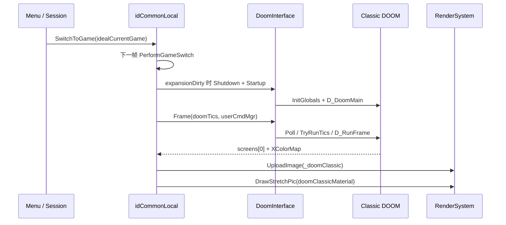

# DOOM Classic 的嵌入式第二运行时

`doomclassic` 保留经典 DOOM 的游戏逻辑、软件渲染、WAD 和声音体系，但不再拥有自己的进程主循环。BFG 的 `idCommonLocal` 负责切换游戏、提供输入、驱动 tic，并把 Classic 帧缓冲交给主渲染器。本页解释这条桥接路径；经典渲染器和玩法算法本身不作逐文件展开。

## 构建与组合边界

`doomclassic.vcxproj` 在 Debug/Release Win32 配置中都生成静态库；`doomexe.vcxproj` 引用它和 `timidity`，所以 Classic 与 DOOM 3 代码链接进同一可执行程序，而不是启动外部 DOOM 进程。[doomclassic/doomclassic.vcxproj:164-180](../../_src/DOOM-3-BFG/doomclassic/doomclassic.vcxproj#L164-L180) [neo/doomexe.vcxproj:520-531](../../_src/DOOM-3-BFG/neo/doomexe.vcxproj#L520-L531)

主要适配层集中在：

- `neo/framework/Common.cpp`：延迟切换和系统事件转换。
- `neo/framework/common_frame.cpp`：Classic 帧驱动、图像上传和最终拉伸绘制。
- `doomclassic/doom/doominterface.*`：玩家级初始化、逐帧 Poll/Tic/Frame 和关闭。
- `doomclassic/doom/doomlib.*`：BFG 与经典全局状态之间的函数桥。
- `doomclassic/doom/w_wad.cpp`、`i_sound_win32.cpp`：主引擎文件系统与 XAudio2 的接入。

## 切换发生在帧边界

菜单选择 DOOM/DOOM II 时只调用 `SwitchToGame` 设置 `idealCurrentGame`；下一次 `idCommonLocal::Frame` 开头才执行 `PerformGameSwitch`，避免在一帧中间换掉运行时。若 session 已越过 IDLE，例如接受邀请，切换逻辑会强制回到 DOOM 3。[neo/d3xp/menus/MenuScreen_Shell_PressStart.cpp:232-250](../../_src/DOOM-3-BFG/neo/d3xp/menus/MenuScreen_Shell_PressStart.cpp#L232-L250) [neo/framework/common_frame.cpp:367-390](../../_src/DOOM-3-BFG/neo/framework/common_frame.cpp#L367-L390) [neo/framework/Common.cpp:1586-1605](../../_src/DOOM-3-BFG/neo/framework/Common.cpp#L1586-L1605)

进入 Classic 时会暂停 DOOM 3 的菜单 sound world，重置 Classic match parameters 和共享 `userCmdMgr`，注册本地用户，并把 latched engine rate 改为 35 Hz；随后 `SetCurrentExpansion` 只设置 expansion id 和 dirty 标记。返回 DOOM 3 时关闭 `DoomLib::Interface`、恢复 CVar 指定的 engine rate，并恢复菜单声音。[neo/framework/Common.cpp:1607-1650](../../_src/DOOM-3-BFG/neo/framework/Common.cpp#L1607-L1650) [doomclassic/doom/doomlib.cpp:120-129](../../_src/DOOM-3-BFG/doomclassic/doom/doomlib.cpp#L120-L129)

初始化与帧调用见 [doominterface.cpp:68-127](../../_src/DOOM-3-BFG/doomclassic/doom/doominterface.cpp#L68-L127) [doominterface.cpp:129-188](../../_src/DOOM-3-BFG/doomclassic/doom/doominterface.cpp#L129-L188)；像素转换、上传和材质绘制见 [common_frame.cpp:709-747](../../_src/DOOM-3-BFG/neo/framework/common_frame.cpp#L709-L747) [common_frame.cpp:217-238](../../_src/DOOM-3-BFG/neo/framework/common_frame.cpp#L217-L238)。

## Classic 主循环已被宿主取代

`DoomLib::InitGame` 仍进入 `D_DoomMain` 完成版本识别、参数和 WAD 等初始化，但原始 `D_DoomLoop` 的无限循环已注释为不使用。之后由 `DoomInterface::Frame` 逐玩家调用 `DoomLib::Poll` 完成延迟启动、`DoomLib::Tic` 进入 `TryRunTics`，再经 `DoomLib::Frame` 调用 `D_RunFrame` 更新显示和声音。[doomclassic/doom/doomlib.cpp:298-340](../../_src/DOOM-3-BFG/doomclassic/doom/doomlib.cpp#L298-L340) [doomclassic/doom/d_main.cpp:331-351](../../_src/DOOM-3-BFG/doomclassic/doom/d_main.cpp#L331-L351) [doomclassic/doom/d_main.cpp:802-863](../../_src/DOOM-3-BFG/doomclassic/doom/d_main.cpp#L802-L863)

宿主的 `RunDoomClassicFrame` 在 expansion dirty 时先 Shutdown/Startup，再调用 `DoomInterface::Frame`。主 `common_frame` 仅在当前为 Classic 且没有暂停对话框或系统 UI 时调用它；Classic 运行期间不会按 DOOM 3 的 map/session 规则触发同一种 `pauseGame`，而是由这条专门条件控制。[neo/framework/common_frame.cpp:409-410](../../_src/DOOM-3-BFG/neo/framework/common_frame.cpp#L409-L410) [neo/framework/common_frame.cpp:617-623](../../_src/DOOM-3-BFG/neo/framework/common_frame.cpp#L617-L623) [neo/framework/common_frame.cpp:709-721](../../_src/DOOM-3-BFG/neo/framework/common_frame.cpp#L709-L721)

## 输入、WAD 与声音的适配

系统事件先经过 console、session 和 dialog；进入 Classic 分支后，`SE_KEY` 被转换为 `ev_keydown`/`ev_keyup`，键码经 `DoomLib::RemapControl` 映射并投递给 `D_PostEvent`。该分支随后消费所有事件，不再继续 DOOM 3 菜单/地图输入路径。[neo/framework/Common.cpp:1512-1554](../../_src/DOOM-3-BFG/neo/framework/Common.cpp#L1512-L1554)

Classic 的 `W_AddFile` 不是直接用 stdio 打开 WAD，而是调用主引擎 `fileSystem->OpenFileRead`，读取 IWAD/PWAD header 和 lump directory，并把 `idFile` handle 保存在 Classic 全局状态中。因此[虚拟文件系统](05-files-declarations.md)的搜索路径同样影响 Classic 资源；本源码快照不包含商业游戏数据，不能仅凭源码构建得到完整 Classic 游戏内容。[doomclassic/doom/w_wad.cpp:126-198](../../_src/DOOM-3-BFG/doomclassic/doom/w_wad.cpp#L126-L198) [doomclassic/doom/d_main.cpp:705-716](../../_src/DOOM-3-BFG/doomclassic/doom/d_main.cpp#L705-L716) [README.txt:12-18](../../_src/DOOM-3-BFG/README.txt#L12-L18)

Classic 音效也保留自己的活动 channel 和空间化逻辑，但最终通过 `soundSystemLocal.hardware.GetIXAudio2()` 创建 `IXAudio2SourceVoice`，直接提交 `XAUDIO2_BUFFER`；它不是把每个 Classic 音效转成 DOOM 3 的 `idSoundWorldLocal` emitter。多玩家声音事件还可先排队，再由每帧 `DoomLib::RunSound` 调用 `I_ProcessSoundEvents` 处理。[doomclassic/doom/i_sound_win32.cpp:281-369](../../_src/DOOM-3-BFG/doomclassic/doom/i_sound_win32.cpp#L281-L369) [doomclassic/doom/i_sound_win32.cpp:377-410](../../_src/DOOM-3-BFG/doomclassic/doom/i_sound_win32.cpp#L377-L410) [doomclassic/doom/i_sound_win32.cpp:698-708](../../_src/DOOM-3-BFG/doomclassic/doom/i_sound_win32.cpp#L698-L708) [doomclassic/doom/doomlib.cpp:550-553](../../_src/DOOM-3-BFG/doomclassic/doom/doomlib.cpp#L550-L553)

## 软件帧缓冲如何进入渲染器

宿主初始化 `_doomClassic` material 和一张 RGBA8、单 mip 的动态图像，尺寸为 `320*3 × 200*3`，即 960×600。[neo/framework/Common.cpp:1184-1197](../../_src/DOOM-3-BFG/neo/framework/Common.cpp#L1184-L1197) [neo/framework/Common_local.h:421-426](../../_src/DOOM-3-BFG/neo/framework/Common_local.h#L421-L426)

当 `DoomInterface::Frame` 报告所有玩家的启动 Poll 已完成，宿主把 Classic `screens[0]` 的每个调色板索引经 `XColorMap` 转成 RGBA，alpha 固定为 255，再调用 `renderSystem->UploadImage`。最终 `idCommonLocal::Draw` 根据当前显示比例计算上下或左右黑边，并用 `doomClassicMaterial` 做一次 `DrawStretchPic`；经典场景不进入 DOOM 3 的 `RenderWorld`、材质阶段或光照交互。[neo/framework/common_frame.cpp:721-747](../../_src/DOOM-3-BFG/neo/framework/common_frame.cpp#L721-L747) [neo/framework/common_frame.cpp:217-250](../../_src/DOOM-3-BFG/neo/framework/common_frame.cpp#L217-L250)

## 修改约束

- 不要恢复原始 `D_DoomLoop` 无限循环；宿主已经负责计时、事件、渲染和关闭。
- 修改 Classic 全局状态时注意 `DoomLib::SetPlayer` 选择当前 `Globals`，初始化和帧逻辑都按玩家切换。
- 修改 tic 或 usercmd 时同步检查 35 Hz 切换、共享 `userCmdMgr` 和暂停条件。
- 修改 Classic 输出尺寸时同步 `screens` 分配、像素转换、图像分配和最终 4:3 拉伸逻辑。
- Classic 的条件网络代码、Timidity 算法和完整玩法未作运行验证；不要把桥接存在等同于多人联机或所有资料片已实测可用。

返回[启动与帧循环](03-startup-frame.md)或[总入口](index.md)。
